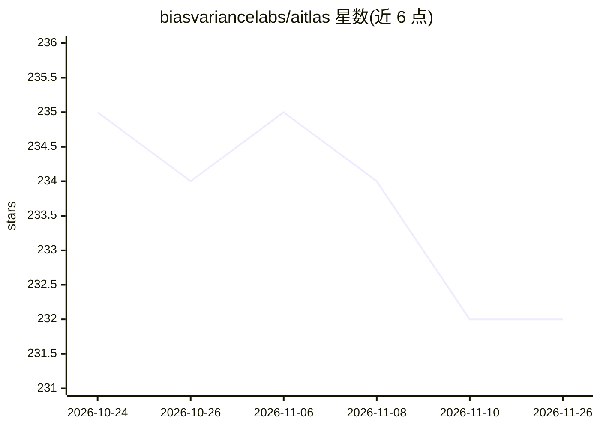

# biasvariancelabs/aitlas

⭐ 232 · Python · Apache-2.0 · 推送 2026-11-13 · [GitHub](https://github.com/biasvariancelabs/aitlas) · [官网](https://aitlas.readthedocs.io/) · 组织维护

**面向地球观测专家的卫星影像 AI 分析工具箱**

AiTLAS（Artificial Intelligence Toolbox for Earth Observation）提供用于卫星影像探索性与预测性分析的机器学习方法库，并附带 AI-ready 的地球观测数据集仓库。支持土地利用/覆盖分类、作物类型预测、语义分割、变化检测与目标检测等任务；2.0 版接入 16 个遥感基础模型并内置数据-模型适配器，含 AMP 训练、检查点恢复等训练机制。Apache-2.0 许可，要求 Python 3.12，可从 PyPI 安装，配套 Jupyter 示例、论文引用格式与基准测试生态（aitlas-arena、语义数据目录）。

## 筛选速览

| 维度 | 判定 | 备注 |
|---|---|---|
| AI 角色 | `ai-native` | 本体是模型或模型工具 |
| 许可风险 | `permissive` | Apache-2.0 |
| 部署形态 | `library` | 以包/库形式分发 |
| 模型依赖 | — | README 未给出锁定关系 |
| 硬件要求 | — | 无带数字的原话,不猜 |
| 安装摩擦 | `low` | 无编译、无系统依赖或容器化 |
| 成熟度 | — | 结构信号不足 |

## 能力要点

- 支持 16 个遥感基础模型（AnySat、Prithvi、SatMAE、TerraMind 等）及输入模态对照表
- 覆盖变化检测、目标检测、分割等多类模型架构（DETR、SegFormer、ChangeFormer 等）
- 提供 Jupyter notebook 示例与基准仓库 aitlas-arena（500+ 模型、22 个数据集）
- 附带 EO 数据集语义数据目录与配套数据集类

## 适用场景

- 对卫星影像做土地利用与覆盖分类
- 做作物类型预测与地物语义分割
- 用基础模型做遥感影像特征提取与变化检测
- 为 EO 任务寻找与下载 AI-ready 数据集

## 场景标签

`目标检测` `模型评测` `科研工具` · 领域:评测与运维

## 证据(README 行号)

> L5: The AiTLAS toolbox (Artificial Intelligence Toolbox for Earth Observation) includes state-of-the-art machine learnin
> L12: - Added comprehensive support for the following **foundation models**: AnySat, CACo, Copernicus-FM, CROMA, DOFA, Ga

## 星数曲线

2026-10-24 235 → 2026-11-26 232（-3）

---
*卡片 v1 · prompt 1.4 · 生成 2026-11-25 · 置信度 high · 依据 README sha `a06c6669ca70` · [字段定义](../../DATASET.md)*
