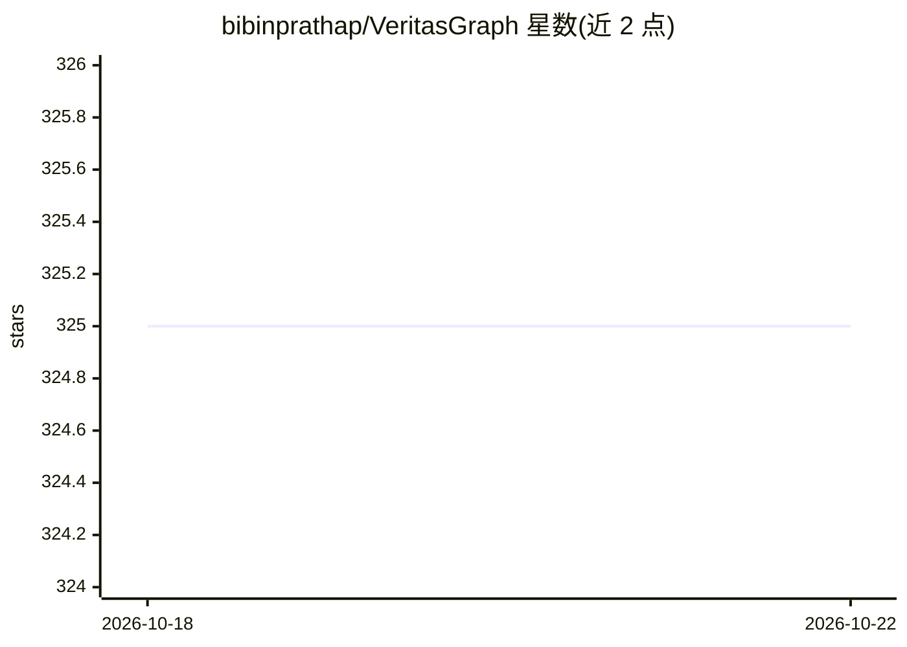

# bibinprathap/VeritasGraph

⭐ 325 · Python · MIT · 推送 2026-10-21 · [GitHub](https://github.com/bibinprathap/VeritasGraph) · [官网](https://bibinprathap.github.io/VeritasGraph/studio/) · 个人维护

**开源 GraphRAG 与治理型 Agent 框架：图结构检索+可验证溯源**

以 Python 包（pip install veritasgraph）提供的知识图谱与 GraphRAG 框架，结合树状导航与图谱多跳推理，写入时存储出处，读取时以 [doc#chunk] 引用回答问题。包含本地 Agent 构建工作台 Studio（FastAPI+单页 UI），提供护栏（PII 脱敏/策略拦截）、记忆、工具目录、MCP 桥接、评测看板等编排能力；可完全本地运行（Ollama）或使用 OpenAI/Anthropic 云 API，full 模式需 Docker+Neo4j。附临床知识图谱、市政事件聊天机器人等示例。MIT 许可。

## 筛选速览

| 维度 | 判定 | 备注 |
|---|---|---|
| AI 角色 | `ai-ecosystem` | LLM/agent 周边工具 |
| 许可风险 | `permissive` | MIT |
| 部署形态 | `self-host` | docker 或自建部署 |
| 模型依赖 | local-ok | 支持本地模型 |
| 硬件要求 | — | 无带数字的原话,不猜 |
| 安装摩擦 | `low` | 无编译、无系统依赖或容器化 |
| 成熟度 | — | 结构信号不足 |

## 能力要点

- 写入时存储出处，回答带 [doc#chunk] 可验证引用
- Studio 本地 Agent 工作台：护栏→记忆→KG→工具→日志编排管线
- 支持 100% 本地（Ollama）或云 API，lite 模式无需 GPU
- 示例覆盖临床 KG（HIPAA 脱敏/ICD-10 归一化）与市政事件机器人

## 适用场景

- 在企业自有数据上构建可溯源的 GraphRAG 问答
- 本地搭建带护栏与审计日志的治理型 AI Agent
- 临床笔记转合规、可引用的患者知识图谱

## 场景标签

`Agent 框架` `RAG` `知识图谱` · 领域:Agent 开发

## 证据(README 行号)

> L1: # VeritasGraph — The Governed, On-Prem GraphRAG & Agent Framework
> L103: **Studio** is a local Agent Build Workspace (FastAPI + single-page UI) that lets you build a knowledge graph from 
> L128: - 🔀 **Governed orchestration pipeline** — per-turn flow of Guardrails → Memory → Knowledge Graph → Headroom budget

## 星数曲线

2026-10-18 325 → 2026-10-22 325（+0）

---
*卡片 v1 · prompt 1.4 · 生成 2026-10-21 · 置信度 mid · 依据 README sha `d14b09a88bda` · [字段定义](../../DATASET.md)*
