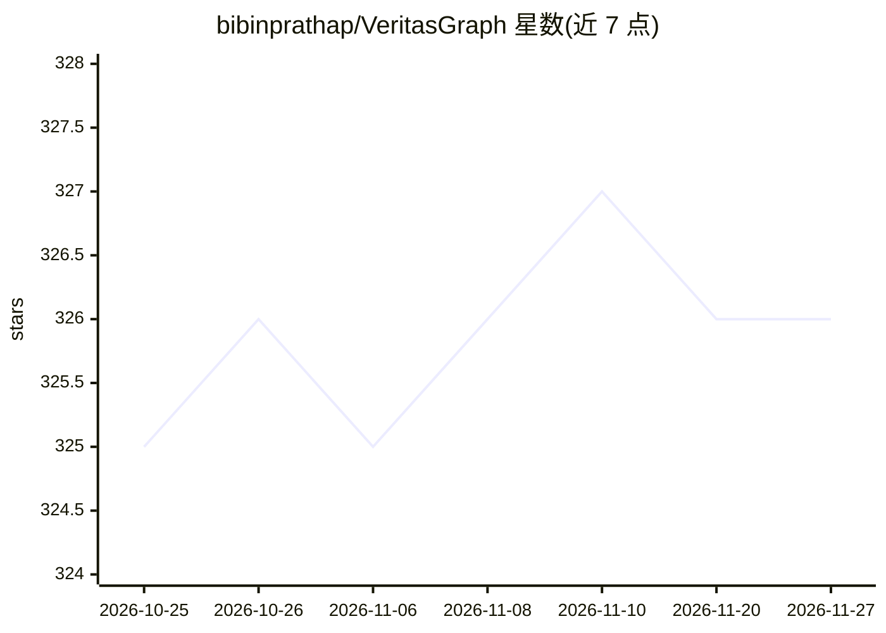

# bibinprathap/VeritasGraph

⭐ 326 · Python · MIT · 推送 2026-11-24 · [GitHub](https://github.com/bibinprathap/VeritasGraph) · [官网](https://bibinprathap.github.io/VeritasGraph/studio/) · 个人维护

**面向企业的本地 GraphRAG 知识图谱框架，每个回答带来源引用**

基于知识图谱的 GraphRAG 与 agent 框架：从自有文档构建图，写入时保存出处实现可验证引用，证据不足时明确拒答而非猜测。核心机制包括本体治理（词汇 certified 工作流约束抽取与回答）、ontology compiler 清洗图谱、SHA-256 哈希链审计日志、PII 策略、角色鉴权，以及可只读接入多种数据库生成 SQL 回答的结构化数据层。提供 Studio 界面、CLI 与 MCP server 三种入口，支持 100% 本地运行（Ollama），也可云端部署。MIT 许可，Python 3.10+。

## 筛选速览

| 维度 | 判定 | 备注 |
|---|---|---|
| AI 角色 | `ai-ecosystem` | LLM/agent 周边工具 |
| 许可风险 | `permissive` | MIT |
| 部署形态 | `self-host` | docker 或自建部署 |
| 模型依赖 | local-ok | 支持本地模型 |
| 硬件要求 | — | 无带数字的原话,不猜 |
| 安装摩擦 | `low` | 无编译、无系统依赖或容器化 |
| 成熟度 | — | 结构信号不足 |

## 能力要点

- 写入时保存出处，引用与实际检索来源严格比对，不符则标记 grounded:false
- 本体与术语表走 proposed→certified→deprecated 治理流程，certified 词汇驱动抽取与回答
- SHA-256 哈希链审计日志、快照恢复、实体合并等治理功能
- 可读接入 Postgres/MySQL/SQLite/DuckDB/ClickHouse/Snowflake 等，自然语言生成 SQL 回答

## 适用场景

- 企业内部数据上构建可审计、带引用的知识图谱问答
- 对 PII 和数据隐私有合规要求的本地部署场景
- 为 IDE 中的 agent 提供图谱推理、记忆与护栏能力
- 对业务数据库做语义层治理并用自然语言查询

## 场景标签

`Agent 框架` `知识图谱` `RAG` `数据分析` · 领域:Agent 开发

## 证据(README 行号)

> L1: # VeritasGraph — The Governed, On-Prem GraphRAG & Agent Framework
> L3: **A knowledge graph your agents can trust: every answer cites its sources, the vocabulary is governed by a certified
> L109: Studio, MCP and the CLI are thin layers over the same engine and store. A graph built in Studio can be queried fro

## 星数曲线

2026-10-25 325 → 2026-11-27 326（+1）

---
*卡片 v1 · prompt 1.4 · 生成 2026-11-25 · 置信度 high · 依据 README sha `67382d75c7fa` · [字段定义](../../DATASET.md)*
