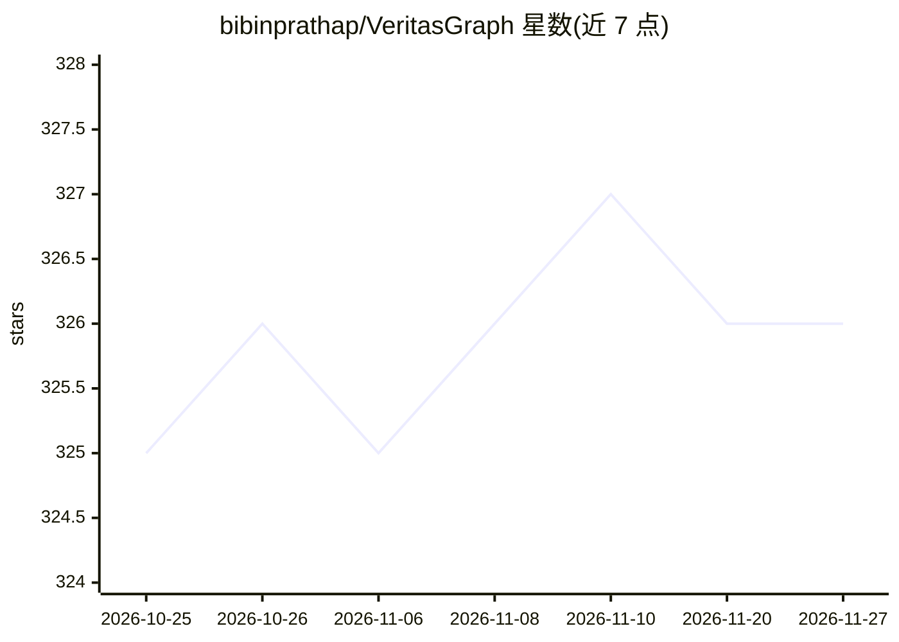

# bibinprathap/VeritasGraph

⭐ 326 · Python · MIT · 推送 2026-11-24 · [GitHub](https://github.com/bibinprathap/VeritasGraph) · [官网](https://bibinprathap.github.io/VeritasGraph/studio/) · 个人维护

**可治理的本地 GraphRAG 与 agent 框架，答案带引用可追溯**

在自有文档上构建知识图谱并做 GraphRAG 问答的框架：写入时为每个实体与关系记录来源 chunk，回答携带引用并与实际检索到的来源比对，无法落地时显式拒绝回答。提供本体（实体类型/谓词/术语表）的 proposed→certified 治理流程与编译器， governed 模式仅在有认证术语覆盖时作答。附带 Studio 工作台、MCP 服务器、CLI、SHA-256 审计日志、PII 策略与角色鉴权，支持纯本地运行（Ollama）与 Docker Compose 部署。

## 筛选速览

| 维度 | 判定 | 备注 |
|---|---|---|
| AI 角色 | `ai-ecosystem` | LLM/agent 周边工具 |
| 许可风险 | `permissive` | MIT |
| 部署形态 | `self-host` | docker 或自建部署 |
| 模型依赖 | local-ok | 支持本地模型 |
| 硬件要求 | — | 无带数字的原话,不猜 |
| 安装摩擦 | `low` | 无编译、无系统依赖或容器化 |
| 成熟度 | — | 结构信号不足 |

## 能力要点

- 写入时存储 provenance，回答引用与检索来源比对，无证据时 abstain
- 本体治理流程：proposed→certified→deprecated，编译器规范化类型与谓词
- SHA-256 哈希链审计日志、快照/恢复、实体合并
- PII 策略（tag/redact/reject）与 viewer/editor/admin 角色鉴权

## 适用场景

- 在企业内网用自有文档构建可溯源的知识图谱问答
- 需要拒绝回答与引用校验的合规场景（如医药、供应链）
- 通过 MCP 在 IDE agent 中接入图谱推理与记忆
- 对结构化数据库建立语义层并用自然语言查询

## 场景标签

`Agent 框架` `知识图谱` `RAG` `文档问答` · 领域:Agent 开发

## 证据(README 行号)

> L1: # VeritasGraph — The Governed, On-Prem GraphRAG & Agent Framework
> L45: |🔌 **MCP modes**|`read` / `write` / `admin` tool tiers, plus new tools: answerability check, ontology, term search,
> L74: pip install -e ".[studio]"                  # Studio + the `veritasgraph` CLI

## 星数曲线

2026-10-25 325 → 2026-11-27 326（+1）

---
*卡片 v1 · prompt 1.4 · 生成 2026-11-27 · 置信度 high · 依据 README sha `c41a3a8a7d87` · [字段定义](../../DATASET.md)*
