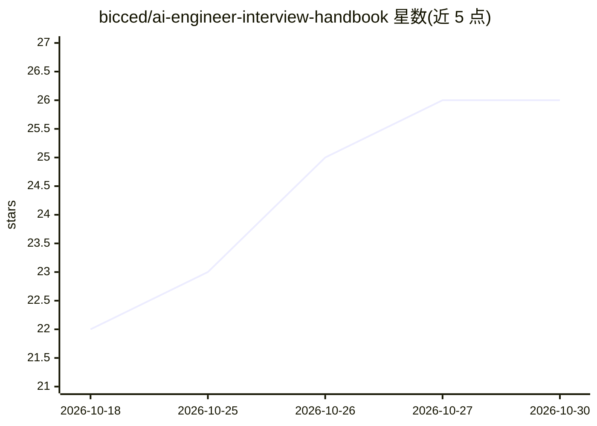

# bicced/ai-engineer-interview-handbook

⭐ 26 · NOASSERTION · 推送 2026-07-23 · [GitHub](https://github.com/bicced/ai-engineer-interview-handbook) · [官网](https://deployprep.vercel.app) · 个人维护

**面向 Applied AI/FDE 岗位的 AI 工程师面试题库与备考手册**

免费开源的面试备考知识手册，针对 Applied AI Engineer 与 Forward Deployed Engineer 岗位，覆盖 LLM、提示工程、RAG、AI agents 与工具调用、评测（evals）、生产化、微调、AI 系统设计、行为面等 11 个主题，附面试题库与快问快答闪卡。提供基于检索检查与间隔重复的学习方法，配套名为 DEPLOYED 的免费训练器（闪卡、检索检查、计时模拟面试）。内容以 CC BY 4.0 许可发布，接受社区投稿真实面试题。

## 筛选速览

| 维度 | 判定 | 备注 |
|---|---|---|
| AI 角色 | `ai-knowledge` | 知识聚合/清单类 |
| 许可风险 | `none` | NOASSERTION |
| 部署形态 | `None` |  |
| 模型依赖 | — | README 未给出锁定关系 |
| 硬件要求 | — | 无带数字的原话,不猜 |
| 安装摩擦 | `low` | 无编译、无系统依赖或容器化 |
| 成熟度 | — | 结构信号不足 |

## 能力要点

- 11 个主题覆盖 LLM/RAG/agents/evals/微调/系统设计
- 面试题库（real-style questions + answers）与快问快答闪卡
- 配套免费训练器 DEPLOYED：间隔重复闪卡、检索检查、计时模拟面试
- 接受社区投稿真实面试题以保持更新

## 适用场景

- 准备 Applied AI Engineer 或 Forward Deployed Engineer 岗位面试
- 系统梳理 LLM/RAG/agents/evals 等技术面试考点
- 通过题库与闪卡做检索式自测与模拟面试练习

## 场景标签

`教程课程` · 领域:学习与行业

## 证据(README 行号)

> L3: > The free, open-source guide to **AI engineer interview questions and answers** for the newest and highest-paid rol
> L17: ## 📚 Topics — AI engineer interview questions by area
> L19: |#|Topic|Covers|

## 星数曲线

2026-10-18 22 → 2026-10-30 26（+4）

---
*卡片 v1 · prompt 1.4 · 生成 2026-10-27 · 置信度 high · 依据 README sha `66b1303da6ac` · [字段定义](../../DATASET.md)*
