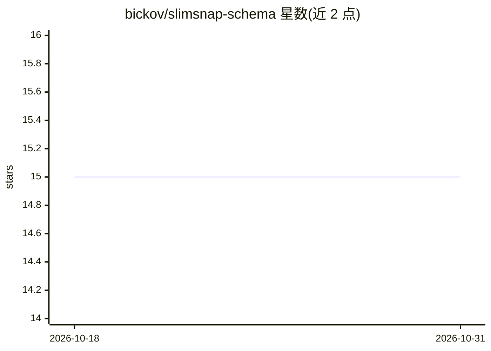

# bickov/slimsnap-schema

⭐ 15 · MIT · 推送 2026-07-10 · [GitHub](https://github.com/bickov/slimsnap-schema) · [官网](https://slimsnap.ai) · 个人维护

**截图转 AI agent 可读 JSON 的开放 MIT 规格**

定义一个 JSON Schema（2020-12 草案）规范：将 Mac 应用 SlimSnap 产出的截图结构化数据——OCR 文本、元素边界框、带 intent 的标注——供无法接收图像的终端 AI agent（Claude Code、Aider 等）作为文本消费。仓库仅含规格与示例；桌面应用闭源（发布期免费，计划付费），格式本身可自由读写实现。提供 Ajv 校验命令与字段级语义化版本说明，附 v1→v2 迁移规则。

## 筛选速览

| 维度 | 判定 | 备注 |
|---|---|---|
| AI 角色 | `ai-ecosystem` | LLM/agent 周边工具 |
| 许可风险 | `permissive` | MIT |
| 部署形态 | `library` | 以包/库形式分发 |
| 模型依赖 | — | README 未给出锁定关系 |
| 硬件要求 | — | 无带数字的原话,不猜 |
| 安装摩擦 | `low` | 无编译、无系统依赖或容器化 |
| 成熟度 | — | 结构信号不足 |

## 能力要点

- JSON Schema 2020-12 规格文件位于 schema/v2.0.json，附示例与 Ajv 校验流程
- frames/elements/annotations/确定性 ID 结构，坐标归一化 0..1
- 滚动截取按帧组织，v1 文档可作为单帧 v2 读取
- MIT 许可，允许第三方自行实现生产者/消费者

## 适用场景

- 让终端 AI agent 以文本形式理解 UI 截图
- 校验 SlimSnap 导出 JSON 的格式合规性
- 构建浏览器扩展、CLI 等自有生产者实现

## 场景标签

`OCR` · 领域:感知与多模态

## 证据(README 行号)

> L7: SlimSnap is a Mac app that turns any screenshot into a small JSON blob: OCR'd text, element bounding boxes, your ann
> L9: This repository is the open, MIT-licensed **specification** of that JSON format. The desktop app that produces it is

## 星数曲线

2026-10-18 15 → 2026-10-31 15（+0）

---
*卡片 v1 · prompt 1.4 · 生成 2026-10-30 · 置信度 mid · 依据 README sha `ad50ab370602` · [字段定义](../../DATASET.md)*
