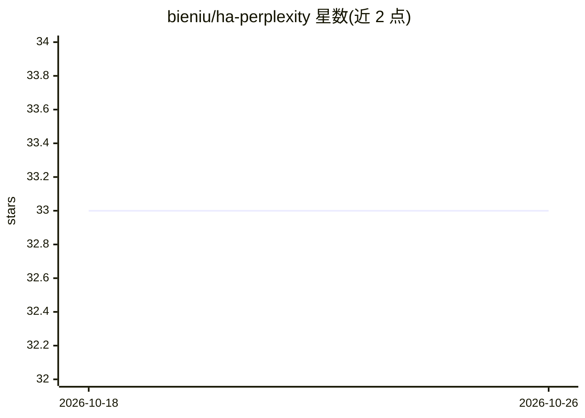

# bieniu/ha-perplexity

⭐ 33 · Python · Apache-2.0 · 推送 2026-10-21 · [GitHub](https://github.com/bieniu/ha-perplexity) · 个人维护

**在 Home Assistant 中接入 Perplexity 的对话助手集成**

Home Assistant 自定义集成，通过 Perplexity Agent API 将 Perplexity 接入 Home Assistant：可作为语音助手的 conversation agent，或作为 AI Task 平台生成数据（如天气描述、摄像头画面物体计数）。提供 Fast/Low/Medium/High 四种预设与可选 reasoning effort 配置，支持通过 Assist API 的 LLM 工具控制实体、GetLiveContext 读取实体实时状态、语音设备定时器与延迟命令。Sonar 模型已停用，存量配置自动迁移为预设。经 HACS 或手动安装，需自行申请 API key。

## 筛选速览

| 维度 | 判定 | 备注 |
|---|---|---|
| AI 角色 | `ai-ecosystem` | LLM/agent 周边工具 |
| 许可风险 | `permissive` | Apache-2.0 |
| 部署形态 | `None` |  |
| 模型依赖 | — | README 未给出锁定关系 |
| 硬件要求 | — | 无带数字的原话,不猜 |
| 安装摩擦 | `low` | 无编译、无系统依赖或容器化 |
| 成熟度 | `idea` | |

## 能力要点

- Conversation 平台与 AI Task 平台两种接入方式
- Fast/Low/Medium/High 预设（Agent API）及可选 reasoning effort 配置
- 通过 Assist 的 LLM 工具控制实体、GetLiveContext 获取实时状态
- Sonar 模型停用后存量条目自动迁移为预设

## 适用场景

- 把 Perplexity 设为我语音助手的对话代理
- 用 AI Task 在家庭助理界面生成天气描述等建议
- 通过对话控制暴露给 Assist 的实体并查询家中设备状态

## 场景标签

`语音 Agent` `AI 助手` · 领域:对话与助手

## 证据(README 行号)

> L11: Perplexity integration for Home Assistant.
> L29: Now you can add Perplexity conversation agent or AI task configuration.
> L54: - **Fast**, **Low**, **Medium** and **High** Perplexity presets (Agent API); see what each preset does

## 星数曲线

2026-10-18 33 → 2026-10-26 33（+0）

---
*卡片 v1 · prompt 1.4 · 生成 2026-10-25 · 置信度 high · 依据 README sha `3e32aca3ba17` · [字段定义](../../DATASET.md)*
