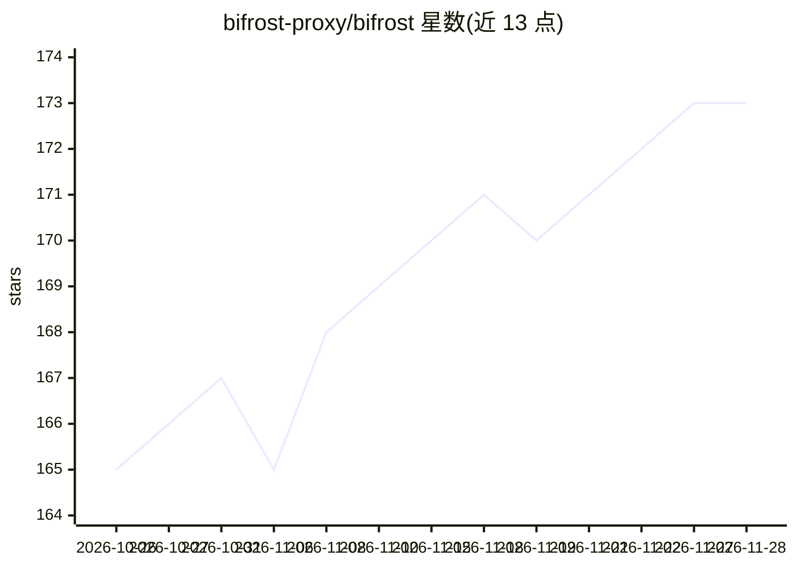

# bifrost-proxy/bifrost

⭐ 173 · Rust · MIT · 推送 2026-11-13 · [GitHub](https://github.com/bifrost-proxy/bifrost) · [官网](https://bifrost-proxy.github.io/) · 组织维护 · 中文 README

**面向开发者的 Rust AI 代理服务器：抓包拦截改写与 Coding Agent 集成**

用 Rust 编写的 HTTP/HTTPS/SOCKS5 代理服务器，灵感来自 Whistle，核心机制包括基于 Tokio+Hyper 的代理内核、TLS 拦截（CA 动态签发、按规则拦截/透传）、规则引擎（改写/Mock/限速/脚本）、断点调试、请求重放与 Web UI 管理。面向需要调试流量和配置代理的开发者，提供 CLI 与 macOS/Windows 桌面端（Linux 仅 CLI）。通过 bifrost install-skill 安装 AI skills，支持配置 Codex、Claude Code 等 CLI Runner 执行 Agent 流水线，并提供类似 Postman 的请求管理与验证能力。

## 筛选速览

| 维度 | 判定 | 备注 |
|---|---|---|
| AI 角色 | `ai-ecosystem` | LLM/agent 周边工具 |
| 许可风险 | `permissive` | MIT |
| 部署形态 | `desktop` | 安装包/桌面程序 |
| 模型依赖 | — | README 未给出锁定关系 |
| 硬件要求 | — | 无带数字的原话,不猜 |
| 安装摩擦 | `low` | 无编译、无系统依赖或容器化 |
| 成熟度 | — | 结构信号不足 |

## 能力要点

- 多协议代理内核（HTTP/1.1、HTTP/2、HTTP/3、SOCKS5、WebSocket、SSE、gRPC）与 TLS 拦截
- 规则引擎支持路由、改写、Mock、断点编辑与 QuickJS 脚本沙箱
- 安装 skills 后可配置 Codex、Claude Code 等 CLI Runner 由 Coding Agent 管理代理
- 提供流量搜索/重放、设备可用性检查与 Web UI 管理端

## 适用场景

- 抓包调试 HTTPS 流量并按域名/路径做规则改写
- 让 Coding Agent 通过安装的 skills 自主管理代理配置
- 在手机/平板上配置代理前先做证书与连通性检查
- 重放并修改历史请求做接口验证

## 场景标签

`编码 Agent` · 领域:编码与开发

## 证据(README 行号)

> L14: Bifrost 是一个用 Rust 编写的高性能，AI 友好的代理服务器，灵感来源于 Whistle。它提供请求拦截、规则修改、TLS 拦截、脚本扩展、流量查看、请求重放以及 Web UI 管理能力。
> L34: 该脚本始终安装 CLI，并在 macOS / Windows 上自动安装同版本桌面 App；Linux 等暂未提供桌面安装包的平台保持 CLI-only。若只需要 CLI，可用 `--no-desktop`（Bash / Git 
> L88: ASR Daily Agent 支持把日报拆成独立研究问题，由明确配置的 Codex、Traex、Claude Code 或自定义 CLI Runner 执行。ChatGPT Web Runner 已移除；迁移说明。

## 星数曲线

2026-10-26 165 → 2026-11-28 173（+8）

---
*卡片 v1 · prompt 1.4 · 生成 2026-11-26 · 置信度 high · 依据 README sha `a2ccd8c36f82` · [字段定义](../../DATASET.md)*
