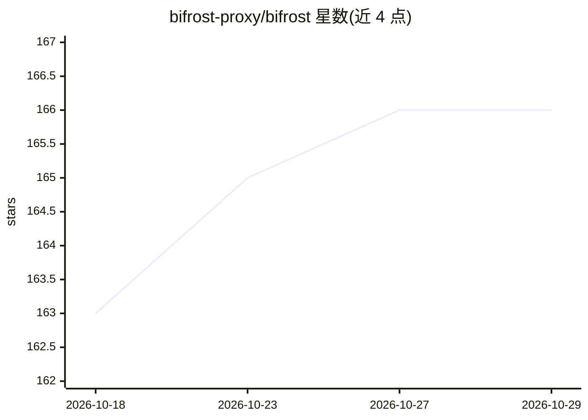

# bifrost-proxy/bifrost

⭐ 166 · Rust · MIT · 推送 2026-10-21 · [GitHub](https://github.com/bifrost-proxy/bifrost) · [官网](https://bifrost-proxy.github.io/) · 组织维护 · 中文 README

**Rust 编写的 HTTP/HTTPS/SOCKS5 代理服务器，带 Web UI 与 Agent 技能**

Bifrost 是用 Rust（Tokio + Hyper）编写的代理服务器，灵感来源于 Whistle，面向需要抓包、调试与改写流量的开发者。提供 HTTP/1.1-3、HTTPS、SOCKS5、WebSocket、SSE、gRPC 多协议支持，规则引擎可做路由、改写、注入、延迟、限速、Mock 与脚本处理（QuickJS 沙箱），支持 TLS 拦截与按域名动态签发证书。内置 Web UI 管理规则、查看流量、断点编辑与请求重放。AI 集成方面提供 `bifrost install-skill` 安装 Agent 技能、由 Coding Agent 自主管理代理。安装途径含脚本、npm 与桌面安装包（macOS .dmg / Windows .msi），Linux 暂为 CLI-only。

## 筛选速览

| 维度 | 判定 | 备注 |
|---|---|---|
| AI 角色 | `ai-enhanced` | 去掉 AI 部分产品仍成立 |
| 许可风险 | `permissive` | MIT |
| 部署形态 | `desktop` | 安装包/桌面程序 |
| 模型依赖 | — | README 未给出锁定关系 |
| 硬件要求 | — | 无带数字的原话,不猜 |
| 安装摩擦 | `low` | 无编译、无系统依赖或容器化 |
| 成熟度 | — | 结构信号不足 |

## 能力要点

- 多协议代理内核：HTTP/1.1-3、HTTPS、SOCKS5、WebSocket、SSE、gRPC
- 规则引擎支持路由、改写、注入、延迟、限速、Mock 与 QuickJS 脚本沙箱
- TLS 拦截：CA 生成、按域名动态签发、按规则选择拦截/透传
- 内置 Web UI：规则编辑、流量查看、Breakpoint 断点编辑、请求重放；可安装 AI Agent 技能

## 适用场景

- 开发调试时抓包、查看与改写 HTTP(S) 流量
- 用规则对指定域名做 Mock、限速、注入 header 等操作
- 在 Web UI 中断点暂停请求并编辑后继续
- 让 Coding Agent 通过技能自主管理代理配置

## 场景标签

 · 领域:网络/开发者工具

## 证据(README 行号)

> L14: Bifrost 是一个用 Rust 编写的高性能，AI 友好的代理服务器，灵感来源于 Whistle。它提供请求拦截、规则修改、TLS 拦截、脚本扩展、流量查看、请求重放以及 Web UI 管理能力。
> L34: 该脚本始终安装 CLI，并在 macOS / Windows 上自动安装同版本桌面 App；Linux 等暂未提供桌面安装包的平台保持 CLI-only。若只需要 CLI，可用 `--no-desktop`（Bash / Git 
> L85: bifrost install-skill -y

## 星数曲线

2026-10-18 163 → 2026-10-29 166（+3）

---
*卡片 v1 · prompt 1.4 · 生成 2026-10-22 · 置信度 high · 依据 README sha `82609401ee05` · [字段定义](../../DATASET.md)*
