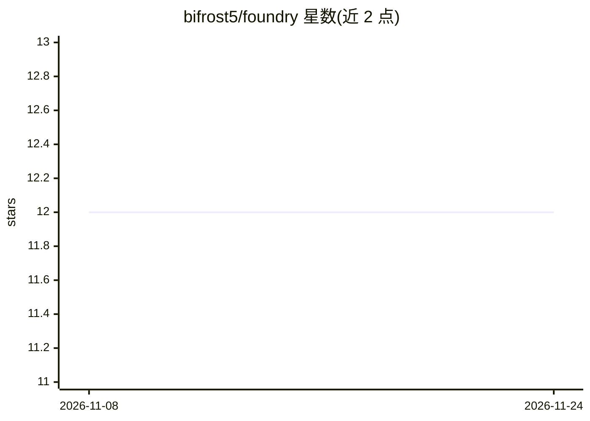

# bifrost5/foundry

⭐ 12 · TypeScript · MIT · 推送 2026-11-18 · [GitHub](https://github.com/bifrost5/foundry) · 个人维护

**AI 编码 agent 的持久化编排控制面，管理长周期任务**

面向多日 agent 编码工作流的控制面：操作者注入目标与带验收标准的任务队列，Foundry 按固定控制循环在隔离沙箱中顺序执行，调度 Cursor、Copilot、Gemini 等 CLI/API 作为 worker 节点，每步将状态持久化到 DragonflyDB，崩溃或中断后可恢复。验证采用本地确定性检查（AST、正则、文件容量）优先、LLM 作为末位裁决的混合管线，降低 token 消耗。提供 UI 面板与 npm CLI 两种操作方式，要求使用者自备各 provider 的订阅密钥。

## 筛选速览

| 维度 | 判定 | 备注 |
|---|---|---|
| AI 角色 | `ai-ecosystem` | LLM/agent 周边工具 |
| 许可风险 | `permissive` | MIT |
| 部署形态 | `library` | 以包/库形式分发 |
| 模型依赖 | local-ok | 支持本地模型 |
| 硬件要求 | — | 无带数字的原话,不猜 |
| 安装摩擦 | `low` | 无编译、无系统依赖或容器化 |
| 成熟度 | `idea` | |

## 能力要点

- 任务级状态持久化（DragonflyDB），支持崩溃后跨天恢复
- 本地确定性检查优先的混合验证管线，LLM 作末位裁决
- 包装标准 CLI/API（Cursor、Copilot、Gemini、Ollama）作为托管 worker 节点
- 确定性任务执行器：不发明目标、不扩展范围

## 适用场景

- 让多个 AI 编码 agent 接力执行多日项目任务队列
- 中断后从持久化状态精确恢复 agent 工作进度
- 用本地校验优先的管线控制 agent 的 token 开销

## 场景标签

`多智能体` `Agent 框架` · 领域:Agent 开发

## 证据(README 行号)

> L7: ### **The persistent control plane for autonomous agentic software development — Kubernetes for AI coding agents**
> L35: Foundry is the **Orchestration Layer for AI Software Engineering**.
> L72: Instead of rebuilding RAG pipelines from scratch, Foundry wraps **standard CLIs & APIs** (Cursor, GitHub Copilot, G

## 星数曲线

2026-11-08 12 → 2026-11-24 12（+0）

---
*卡片 v1 · prompt 1.4 · 生成 2026-11-18 · 置信度 mid · 依据 README sha `3228d8cee1d6` · [字段定义](../../DATASET.md)*
