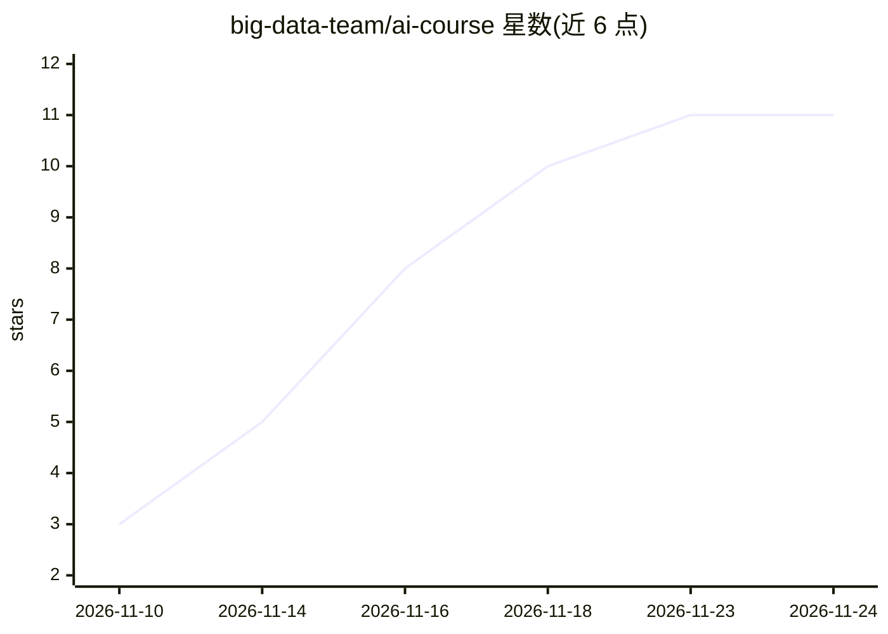

# big-data-team/ai-course

⭐ 11 · Python · 推送 2026-11-20 · [GitHub](https://github.com/big-data-team/ai-course) · [官网](https://bigdatateam.org/ru/artificial-intelligence-course) · 组织维护

**AI Agents 工程师课程的代码作业与练习仓库**

Big Data Team 用于其 AI Agents 工程师专项课程（Practical AI Course）的配套代码仓库。内容为课程练习的起始文件与作业说明，课程主题包括 AI agents 与 MCP 工具、agentic coding、LLM、evals、context & memory、agent harness 及 capstone 项目。仓库给出基于 uv 与 Python 3.10 的环境配置流程，并以 HW01（日期时间解析 MCP 工具）为例提供作业模板、自检脚本与评分细则，作业在 Grader 上自动评分。

## 筛选速览

| 维度 | 判定 | 备注 |
|---|---|---|
| AI 角色 | `ai-knowledge` | 知识聚合/清单类 |
| 许可风险 | `none` | — |
| 部署形态 | `library` | 以包/库形式分发 |
| 模型依赖 | — | README 未给出锁定关系 |
| 硬件要求 | — | 无带数字的原话,不猜 |
| 安装摩擦 | `low` | 无编译、无系统依赖或容器化 |
| 成熟度 | — | 结构信号不足 |

## 能力要点

- 课程主题覆盖 AI agents、MCP 工具、agentic coding、evals、agent harness 等模块
- 提供基于 uv 与 Python 3.10 的统一环境配置流程
- HW01 作业含 MCP Tool 描述文件 tool.json、测试用例与自检脚本
- 评分体系公开权重：开放用例 0.3、隐藏用例 0.5、契约检查 0.2

## 适用场景

- 学习构建 MCP 工具并完成带自动评分的编程作业
- 按课程大纲系统学习 agent harness、context/memory 等概念
- 教师或学员搭建与 Grader 一致的 Python 3.10 运行环境

## 场景标签

`教程课程` · 领域:学习与行业

## 证据(README 行号)

> L3: The repository is used during the following courses:
> L4: 1. Practical AI Course: Agentic Coding & AI Agents (AI Agents Engineer Specialization)
> L45: ## HW01: AI Tool for Datetime Parsing (`ai.tool_datetime_parser`)

## 星数曲线

2026-11-10 3 → 2026-11-24 11（+8）

---
*卡片 v1 · prompt 1.4 · 生成 2026-11-19 · 置信度 high · 依据 README sha `eb89ed70455d` · [字段定义](../../DATASET.md)*
