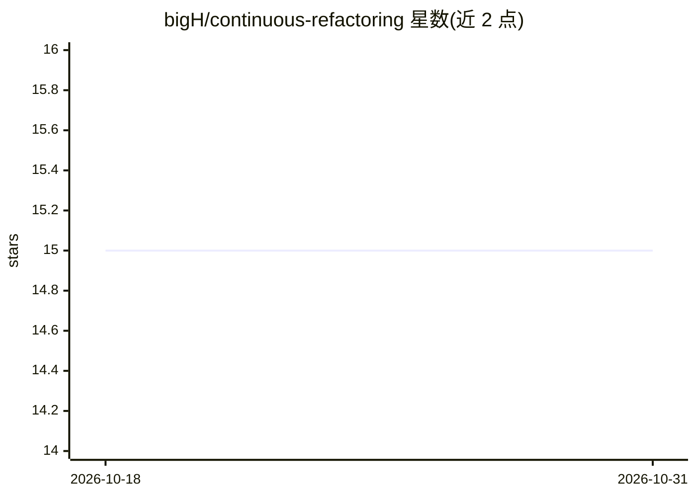

# bigH/continuous-refactoring

⭐ 15 · Python · MIT · 推送 2026-06-27 · [GitHub](https://github.com/bigH/continuous-refactoring) · 个人维护

**驱动 AI 编码代理做测试门控自动重构循环的 CLI 工具**

面向开发者的 Python CLI：调用 codex 或 claude CLI 作为代理后端，循环提出重构改动，先运行项目验证命令（默认 uv run pytest），通过则在本地提交，失败则回退重试，直到耗尽动作/重试/连续失败预算。支持按 targets/globs/extensions/paths 选目标、taste 偏好文档的代理生成与迭代、大型迁移的分阶段规划/审查/修正。安全机制包括拒绝脏工作树、基线验证先红即停、5 分钟静默看门狗。要求 Python 3.10+、uv、git 干净仓库及 codex/claude CLI。

## 筛选速览

| 维度 | 判定 | 备注 |
|---|---|---|
| AI 角色 | `ai-ecosystem` | LLM/agent 周边工具 |
| 许可风险 | `permissive` | MIT |
| 部署形态 | `library` | 以包/库形式分发 |
| 模型依赖 | — | README 未给出锁定关系 |
| 硬件要求 | — | 无带数字的原话,不猜 |
| 安装摩擦 | `low` | 无编译、无系统依赖或容器化 |
| 成熟度 | — | 结构信号不足 |

## 能力要点

- 测试门控的重构循环：验证通过才本地提交，失败回退重试
- 支持 codex 与 claude CLI 两种代理后端及多档 effort 控制
- taste.md 偏好文档可由代理访谈生成并迭代精炼
- 迁移工作流含分阶段规划、human review 交接与 doctor 一致性检查
- 全程可审计：summary.json、events.jsonl、逐次尝试日志

## 适用场景

- 让 AI 代理在测试保护下批量清理重构代码库
- 我有多余 token 预算，想让代理持续做小步清理提交
- 为大型重构建立分阶段迁移规划并人工审查
- 用自然语言指令限定代理只重构某个模块

## 场景标签

`编码 Agent` · 领域:编码与开发

## 证据(README 行号)

> L8: Small, test-gated cleanup commits by an AI coding agent.
> L95: - `codex` or `claude` CLI on your `PATH` (whichever backend you pick)
> L87: - Runs your validation command (default: `uv run pytest`).

## 星数曲线

2026-10-18 15 → 2026-10-31 15（+0）

---
*卡片 v1 · prompt 1.4 · 生成 2026-10-31 · 置信度 high · 依据 README sha `00f0a0e0d4ab` · [字段定义](../../DATASET.md)*
