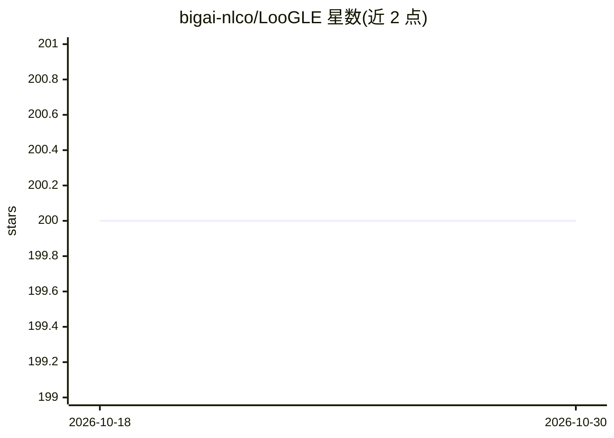

# bigai-nlco/LooGLE

⭐ 200 · Python · MIT · 推送 2026-08-06 · [GitHub](https://github.com/bigai-nlco/LooGLE) · 组织维护

**LLM 长上下文理解评测基准：超长文档与 7 类任务数据集**

ACL 2024 论文配套的长上下文评测基准：收录 2022 年后真实长文档（超 24k token，部分超 10 万词）与 6,000 道新生成问题，覆盖 7 类任务（短依赖 QA/完形填空，长依赖的理解推理、计算、时间线重排、多信息检索、摘要）。提供 GPT 系、开源模型与 LlamaIndex 检索式三种预测脚本，评测采用语义相似度自动指标、GPT-4 评分与人工评估，时间线重排提供 LSD/LMD/SD/SDD 四个专用指标。开源基线在单张 80G A800 GPU（BF16）上测试。

## 筛选速览

| 维度 | 判定 | 备注 |
|---|---|---|
| AI 角色 | `ai-knowledge` | 知识聚合/清单类 |
| 许可风险 | `permissive` | MIT |
| 部署形态 | `library` | 以包/库形式分发 |
| 模型依赖 | — | README 未给出锁定关系 |
| 硬件要求 | — | 无带数字的原话,不猜 |
| 安装摩擦 | `medium` | 含编译或系统依赖之一 |
| 成熟度 | — | 结构信号不足 |

## 能力要点

- 超 24k token 真实长文档与 6,000 道问题的评测数据集
- 7 类短/长依赖任务，含时间线重排专用指标（LSD/LMD/SD/SDD）
- 支持 GPT 系、开源模型、检索式（LlamaIndex）三类预测脚本
- 评测含自动指标、GPT-4-as-judge 与人工评估

## 适用场景

- 评测自有 LLM 的长上下文理解能力
- 比较不同模型在长依赖任务上的表现
- 复现论文中 8 个代表性 LLM 的评测结果

## 场景标签

`模型评测` · 领域:评测与运维

## 证据(README 行号)

> L16: **LooGLE** is a comprehensive evaluation benchmark for LLM long context understanding which contains up-to-date (al
> L18: **Short and long dependency tasks 📜** LooGLE is composed of 7 major tasks to evaluate LLMs' ability to understand b

## 星数曲线

2026-10-18 200 → 2026-10-30 200（+0）

---
*卡片 v1 · prompt 1.4 · 生成 2026-10-22 · 置信度 mid · 依据 README sha `ddaba5012d50` · [字段定义](../../DATASET.md)*
