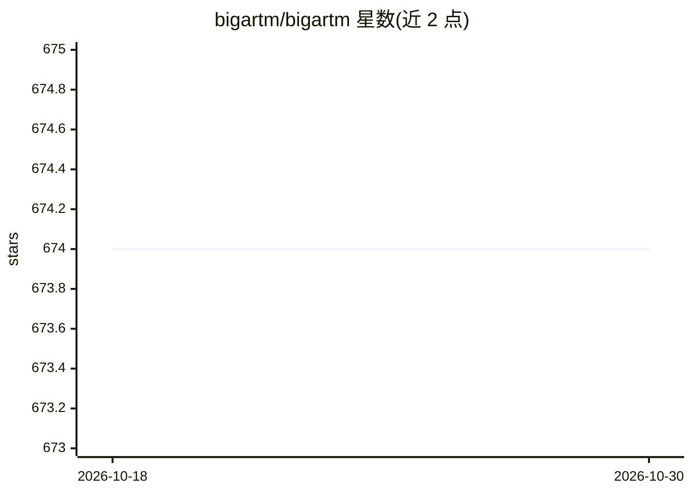

# bigartm/bigartm

⭐ 674 · C++ · NOASSERTION · 推送 2026-02-05 · [GitHub](https://github.com/bigartm/bigartm) · [官网](http://bigartm.org/) · 组织维护

**面向大数据集的正则化主题建模开源平台**

基于加性正则化（ARTM）技术的主题建模 C++ 平台，通过在优化准则中加入多个加权正则器（稀疏化、平滑、主题去相关等）构建多目标模型，支持多模态主题建模。提供命令行工具、Python API 与 C/C++ 低层接口。Linux 平台可通过 pip 安装，Windows 提供预编译二进制，Linux/macOS 可用 cmake 从源码构建。配套 TopicNet 高层接口用于原型开发与模型探索。

## 筛选速览

| 维度 | 判定 | 备注 |
|---|---|---|
| AI 角色 | `ai-native` | 本体是模型或模型工具 |
| 许可风险 | `none` | NOASSERTION |
| 部署形态 | `desktop` | 安装包/桌面程序 |
| 模型依赖 | — | README 未给出锁定关系 |
| 硬件要求 | — | 无带数字的原话,不猜 |
| 安装摩擦 | `medium` | 含编译或系统依赖之一 |
| 成熟度 | — | 结构信号不足 |

## 能力要点

- 加性正则化（ARTM）构建多目标主题模型
- 支持稀疏化、平滑、主题去相关等多种正则器组合
- 提供命令行、Python API、C++/C 低层接口三种使用方式
- 多模态主题建模与大数据集支持

## 适用场景

- 对大规模文本集合做主题建模与主题分析
- 通过多正则器组合训练稀疏主题模型
- 在 Python 或 C++ 项目中嵌入主题建模能力

## 场景标签

 · 领域:文本挖掘/机器学习

## 证据(README 行号)

> L17: BigARTM is a powerful tool for topic modeling based on a novel technique called Additive Regularization of Topic Mo
> L21: * Vorontsov K., Frei O., Apishev M., Romov P., Dudarenko M. BigARTM: Open Source Library for Regularized Multimodal
> L102: BigARTM supports full-featured and clear Python API (see Installation to configure Python API for your OS).

## 星数曲线

2026-10-18 674 → 2026-10-30 674（+0）

---
*卡片 v1 · prompt 1.4 · 生成 2026-10-21 · 置信度 high · 依据 README sha `0f070ba5a2dc` · [字段定义](../../DATASET.md)*
