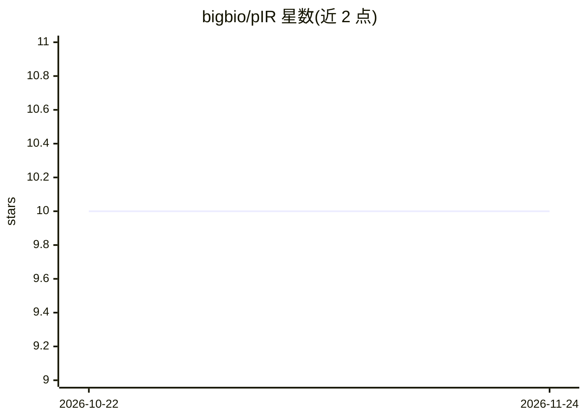

# bigbio/pIR

⭐ 10 · R · 推送 2026-04-15 · [GitHub](https://github.com/bigbio/pIR) · 组织维护

**基于 SVM 的肽/蛋白质等电点估算 R 包**

R 语言包，基于实验值与多种预测函数分析肽和蛋白质的等电点，使用支持向量机（SVM）方法，提供统计框架分析预测值与期望值之间的相关性，支持多种 pK 数据集（rodwell、emboss、lehninger、grimsley、patrickios、DtaSelect）。通过 devtools 从 GitHub 安装，附有示例代码与引用文献，已被蛋白质组学研究使用。

## 筛选速览

| 维度 | 判定 | 备注 |
|---|---|---|
| AI 角色 | `ai-native` | 本体是模型或模型工具 |
| 许可风险 | `none` | — |
| 部署形态 | `None` |  |
| 模型依赖 | — | README 未给出锁定关系 |
| 硬件要求 | — | 无带数字的原话,不猜 |
| 安装摩擦 | `low` | 无编译、无系统依赖或容器化 |
| 成熟度 | — | 结构信号不足 |

## 能力要点

- 支持向量机（SVM）估算肽/蛋白质等电点
- 统计框架分析预测值与实验值的相关性
- 可选多种 pK 数据集（rodwell、emboss、lehninger 等）
- 提供引用文献与使用案例

## 适用场景

- 基于氨基酸序列预测蛋白质等电点
- 比较不同预测函数与实验值的偏差
- 蛋白质组学实验（如肽分级分离）中的等电点分析

## 场景标签

`科研工具` · 领域:学习与行业

## 证据(README 行号)

> L6: An R package to analyze the isoelectric point of peptides and proteins based on experimental values and predicted us
> L37: Perez-Riverol, Y., Audain, E., Millan, A., Ramos, Y., Sanchez, A., Vizcaíno, J. A., ... & González, L. J. (2012). I

## 星数曲线

2026-10-22 10 → 2026-11-24 10（+0）

---
*卡片 v1 · prompt 1.4 · 生成 2026-11-19 · 置信度 high · 依据 README sha `18752c25f0d9` · [字段定义](../../DATASET.md)*
