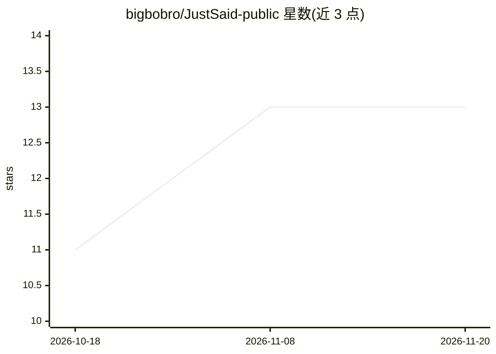

# bigbobro/JustSaid-public

⭐ 13 · Swift · MIT · 推送 2026-11-12 · [GitHub](https://github.com/bigbobro/JustSaid-public) · 个人维护 · 中文 README

**给 macOS 用户本机实时转写并整理会议记录的工具**

开源的 macOS 会议记录应用：本机运行 Qwen3-ASR 对麦克风与系统声音两路实时转写，会中按话题整理成表格、时间线和要点，提供点名提醒、待办四象限、闲聊过滤、认名、会议库全文搜索等功能。会后精转依赖用户自行配置的识别服务（豆包录音文件识别加 Cloudflare R2 中转），总结与纪要用用户自己的 OpenAI 兼容模型服务或 ChatGPT 订阅。仅支持 Apple Silicon 与 macOS 15+，安装包未经 Apple 公证，需手动放行。

## 筛选速览

| 维度 | 判定 | 备注 |
|---|---|---|
| AI 角色 | `ai-native` | 本体是模型或模型工具 |
| 许可风险 | `permissive` | MIT |
| 部署形态 | `desktop` | 安装包/桌面程序 |
| 模型依赖 | — | README 未给出锁定关系 |
| 硬件要求 | — | 无带数字的原话,不猜 |
| 安装摩擦 | `low` | 无编译、无系统依赖或容器化 |
| 成熟度 | — | 结构信号不足 |

## 能力要点

- 本机运行 Qwen3-ASR 实时双路转写，会中音频不上传
- 会中按话题自动整理表格、时间线、关键数字或层级图
- 会后精转、纪要使用用户自配的模型服务或 API Key
- 点名提醒、待办四象限、认名与会议库检索

## 适用场景

- 开会时本机实时转写并边听边整理讨论内容
- 会后用自己的模型生成纪要和行动清单
- 把已有音频视频文件导入走精转并出纪要

## 场景标签

`语音识别` `AI 写作` · 领域:内容生成

## 证据(README 行号)

> L7: 开源的 macOS 会议记录工具：本机实时转写，边开会边把讨论整理成表格、时间线和要点，会后用你自己的模型出纪要。
> L19: - **本机实时转写。** 麦克风和系统声音两路同时转写，用本机运行的 Qwen3-ASR，会中转写不上传音频。

## 星数曲线

2026-10-18 11 → 2026-11-20 13（+2）

---
*卡片 v1 · prompt 1.4 · 生成 2026-11-18 · 置信度 high · 依据 README sha `a2120e2deebc` · [字段定义](../../DATASET.md)*
