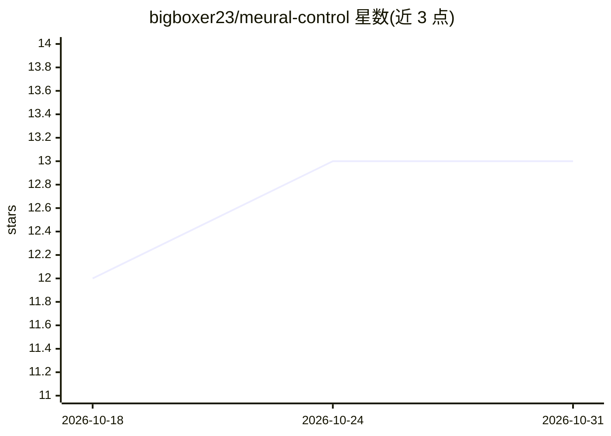

# bigboxer23/meural-control

⭐ 13 · Java · Apache-2.0 · 推送 2026-10-26 · [GitHub](https://github.com/bigboxer23/meural-control) · 个人维护

**向 Meural 数字画框推送官方不支持来源内容的 Java 服务**

运行在本地服务器（如树莓派）上的 Java Web 服务，通过 Meural 官方 API 与设备端 HTTP 接口控制 Netgear 账号下的 Meural 画框，按 cron 周期轮播内容。内容来源包括：OpenAI gpt-image-1.5 文生图（提示词经 GPT 文本补全逐步演化，可结合美国节假日日历生成主题图，需 OpenAI credits）、Google Photos 相册（OAuth 认证）、JWST 官网抓取、外部 URL（png/jpg/gif）。提供 Swagger 文档化的 REST 端点，配置通过 application.properties 完成，安装依赖 Maven 与 Java 17+。

## 筛选速览

| 维度 | 判定 | 备注 |
|---|---|---|
| AI 角色 | `ai-enhanced` | 去掉 AI 部分产品仍成立 |
| 许可风险 | `permissive` | Apache-2.0 |
| 部署形态 | `None` |  |
| 模型依赖 | — | README 未给出锁定关系 |
| 硬件要求 | — | 无带数字的原话,不猜 |
| 安装摩擦 | `medium` | 含编译或系统依赖之一 |
| 成熟度 | — | 结构信号不足 |

## 能力要点

- OpenAI 文生图提示词随每次生成逐步演化（GPT-3/4 补全驱动）
- Google Photos OAuth 集成与生成图回存相册
- JWST 新图抓取与外部 URL 推送（png/jpg/gif）
- Swagger 文档化 REST 端点与外部图像变换命令钩子

## 适用场景

- 让 Meural 画框轮播自己 Google Photos 相册的照片
- 用文字提示词在画框上持续展示 AI 生成画作
- 追踪并展示韦伯望远镜新发布的图片

## 场景标签

`图像生成` `网页抓取` · 领域:效率与自动化

## 证据(README 行号)

> L5: This project provides ability to push content to a Meural display from content sources not supported by the official
> L40: This source allows using OpenAI's gpt-image-1.5 text to image generator to create custom images to display on the f

## 星数曲线

2026-10-18 12 → 2026-10-31 13（+1）

---
*卡片 v1 · prompt 1.4 · 生成 2026-10-31 · 置信度 high · 依据 README sha `393643ce89fc` · [字段定义](../../DATASET.md)*
