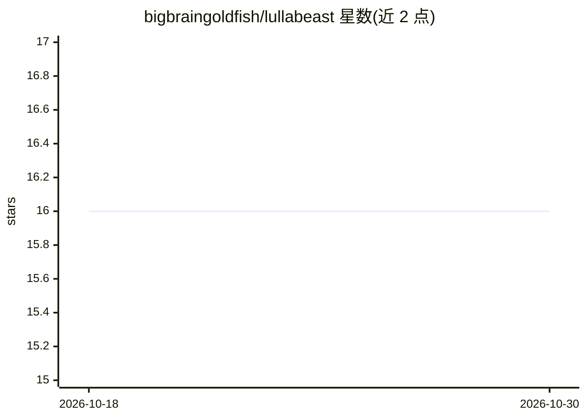

# bigbraingoldfish/lullabeast

⭐ 16 · Python · MIT · 推送 2026-07-21 · [GitHub](https://github.com/bigbraingoldfish/lullabeast) · [官网](https://lullabeast.ai) · 个人维护

**门控多智能体开发流水线：用开源模型从想法自动产出可运行应用**

运行在 OpenClaw 运行时之上的自主开发流水线与仪表盘：用户用自然语言描述想法，planner/executor/reviewer 等六个 agent 按阶段对真实 git 仓库实施开发，步骤间由确定性、无 LLM 的 Python 门控脚本校验（文件清单、git diff、测试结果等），失败三次后升级回人工。模型无关，支持 OpenRouter 云端开源模型、单卡本地 llama.cpp 运行或混合模式。Docker Compose 部署，自称早期 beta，单用户工具，可靠完成小型单用途 web 应用，较大项目仍需人工打磨。

## 筛选速览

| 维度 | 判定 | 备注 |
|---|---|---|
| AI 角色 | `ai-ecosystem` | LLM/agent 周边工具 |
| 许可风险 | `permissive` | MIT |
| 部署形态 | `self-host` | docker 或自建部署 |
| 模型依赖 | local-ok | 支持本地模型 |
| 硬件要求 | — | 无带数字的原话,不猜 |
| 安装摩擦 | `low` | 无编译、无系统依赖或容器化 |
| 成熟度 | `idea` | |

## 能力要点

- planner/executor/reviewer 循环 + 无 LLM 确定性门控脚本校验每步交接
- 模型无关：OpenRouter 云端开源模型、本地 llama.cpp 或混合模式
- 队列多项目、依赖感知、三重尝试后升级回人工
- Docker 镜像内置固定版本的 OpenClaw/Python/Node/Chromium，仅需 Docker 与 API key

## 适用场景

- 用便宜开源模型把小想法自动做成可运行的 web 应用 MVP
- 排队批量构建多个小型项目并跟踪依赖
- 在单张 GPU 上全本地运行智能体开发流水线

## 场景标签

`Agent 框架` `多智能体` `编码 Agent` `代码生成` · 领域:Agent 开发

## 证据(README 行号)

> L12: Lullabeast is an open-source, local-capable, autonomous development pipeline. Describe what you want to build in pl
> L14: Lullabeast runs on OpenClaw and requires it: Lullabeast is the pipeline and dashboard, while the agents themselves 
> L18: > **Early release, and honest about it.** Lullabeast reliably builds small, single-purpose webapps end to end, and 

## 星数曲线

2026-10-18 16 → 2026-10-30 16（+0）

---
*卡片 v1 · prompt 1.4 · 生成 2026-10-30 · 置信度 high · 依据 README sha `d7737bb7ad07` · [字段定义](../../DATASET.md)*
