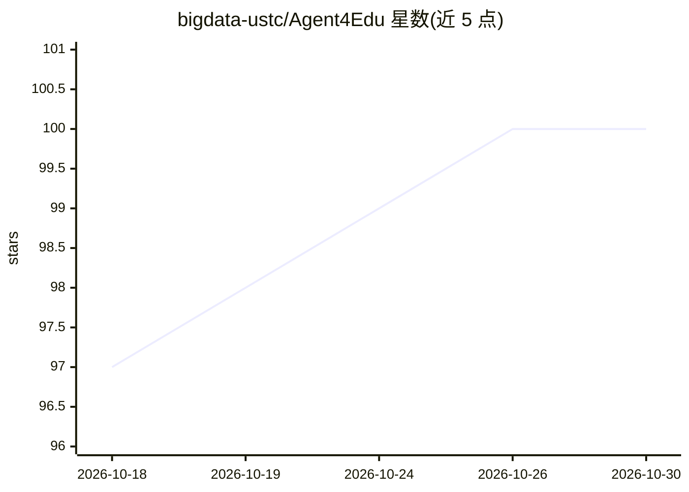

# bigdata-ustc/Agent4Edu

⭐ 100 · Python · 推送 2026-09-29 · [GitHub](https://github.com/bigdata-ustc/Agent4Edu) · 组织维护 · 中文 README

**用 LLM 智能体生成学习者答题行为模拟数据的教育研究代码库**

AAAI 2025 论文 Agent4Edu 的官方实现：构建 LLM 驱动的学习者智能体，按论文流程（学习者画像构建、记忆构建、动作模拟、与个性化学习任务交互）模拟学习者作答数据与解题行为。管线整合 IRT 估计能力、DNeuralCDM 导出知识掌握度、RCD 工具构建知识概念图；记忆模块含事实/短期/长期记忆。支持 OpenAI 或 OpenAI 兼容 API，demo 可用 mock provider 无 key 运行。面向智能教育系统研究者，需 conda 环境并从源码跑 Python 脚本，无打包产品。

## 筛选速览

| 维度 | 判定 | 备注 |
|---|---|---|
| AI 角色 | `ai-native` | 本体是模型或模型工具 |
| 许可风险 | `none` | — |
| 部署形态 | `library` | 以包/库形式分发 |
| 模型依赖 | — | README 未给出锁定关系 |
| 硬件要求 | — | 无带数字的原话,不猜 |
| 安装摩擦 | `low` | 无编译、无系统依赖或容器化 |
| 成熟度 | — | 结构信号不足 |

## 能力要点

- LLM 智能体模拟学习者作答与解题过程，生成模拟响应数据
- 整合 IRT 能力估计、DNeuralCDM 知识掌握度导出与 RCD 知识概念图构建
- 三类记忆（事实/短期/长期）与遗忘机制，KCG 关系用于记忆强化
- demo 数据支持 mock provider 本地运行，无需 API key

## 适用场景

- 为智能教育系统生成模拟学习者答题数据
- 研究认知诊断与自适应测验的数据仿真方法
- 复现 AAAI 2025 论文实验流程

## 场景标签

 · 领域:智能教育/教育数据挖掘

## 证据(README 行号)

> L3: Official implementation for **Agent4Edu: Generating Learner Response Data by Generative Agents for Intelligent Educa
> L5: Agent4Edu builds LLM-powered learner agents to simulate learner response data and problem-solving behaviors for inte

## 星数曲线

2026-10-18 97 → 2026-10-30 100（+3）

---
*卡片 v1 · prompt 1.4 · 生成 2026-10-23 · 置信度 high · 依据 README sha `048987fe6238` · [字段定义](../../DATASET.md)*
