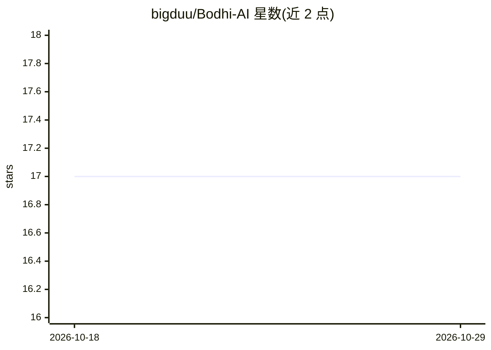

# bigduu/Bodhi-AI

⭐ 17 · JavaScript · MIT · 推送 2026-10-28 · [GitHub](https://github.com/bigduu/Bodhi-AI) · [官网](https://bodhi-ai.vercel.app) · 个人维护 · 中文 README

**本地优先的桌面 AI agent 窗口：管理 Bamboo 运行时执行任务**

基于 Tauri 的桌面壳应用，打包并管理 Bamboo agent 运行时（sidecar），启动后打开 Lotus Next 界面。用户可在桌面窗口中给 agent 布置任务，查看每次工具调用与审批；能力包括读写文件、执行命令、网页检索，支持 cron 定时任务与 MCP 扩展（Jiandu 共享内存、Nova 原生应用控制）。模型由 Anthropic、OpenAI（及兼容端点）、Gemini 或 GitHub Copilot 提供，本地执行不等于模型本地运行。提供 macOS Apple Silicon、Windows x64、Linux x64 安装包，源码构建需 Node.js 22.12+ 与 Rust 1.95+。

## 筛选速览

| 维度 | 判定 | 备注 |
|---|---|---|
| AI 角色 | `ai-native` | 本体是模型或模型工具 |
| 许可风险 | `permissive` | MIT |
| 部署形态 | `desktop` | 安装包/桌面程序 |
| 模型依赖 | — | README 未给出锁定关系 |
| 硬件要求 | — | 无带数字的原话,不猜 |
| 安装摩擦 | `low` | 无编译、无系统依赖或容器化 |
| 成熟度 | — | 结构信号不足 |

## 能力要点

- 打包并管理 Bamboo agent 运行时（独立 sidecar，默认端口 9562）
- 读取/编辑文件、运行命令、检索网页，风险操作前请求审批
- cron 式定时任务与 MCP 扩展（Jiandu 共享内存、Nova 应用控制）
- 可选 Anthropic / OpenAI 兼容端点 / Gemini / GitHub Copilot 提供方

## 适用场景

- 在桌面窗口里让 agent 处理本地项目任务并逐条审批工具调用
- 让 agent 按定时计划持续处理工作
- 从终端用 bamboo CLI 复用同一本地引擎

## 场景标签

`GUI 自动化` `AI 助手` · 领域:效率与自动化

## 证据(README 行号)

> L5: **Your local-first AI agent, in a desktop window.** Hand it a task, watch every
> L20: - **Your choice of model:** Anthropic, OpenAI (and OpenAI-compatible endpoints),
> L59: - **Keep execution visible:** Lotus Next presents conversations, tool calls and permission prompts; Bamboo performs

## 星数曲线

2026-10-18 17 → 2026-10-29 17（+0）

---
*卡片 v1 · prompt 1.4 · 生成 2026-10-29 · 置信度 high · 依据 README sha `a33e575d2086` · [字段定义](../../DATASET.md)*
