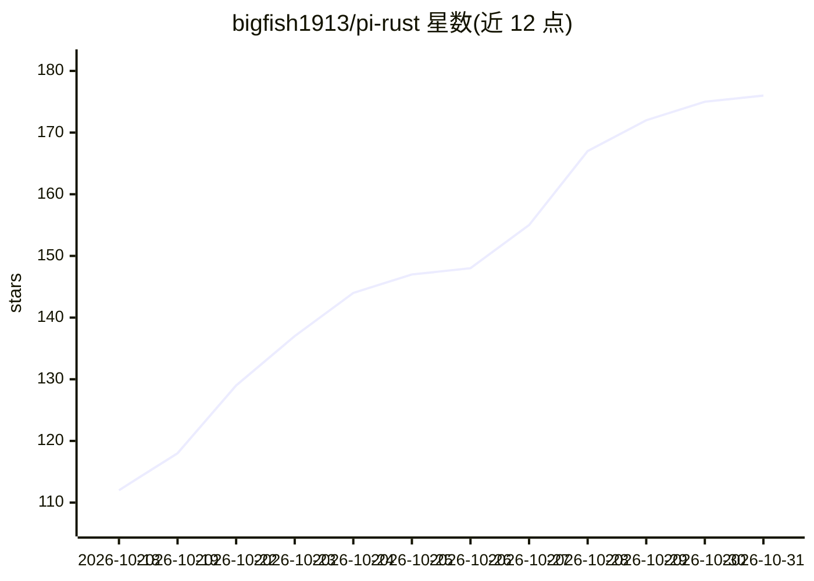

# bigfish1913/pi-rust

⭐ 176 · Rust · MIT · 推送 2026-10-30 · [GitHub](https://github.com/bigfish1913/pi-rust) · [官网](https://rpi.bigfisharc.cn/) · 个人维护

**Rust 编写的库优先 coding-agent 运行时与终端 CLI**

以九个可组合 crate 提供 coding-agent 运行时：provider 适配层（Anthropic、OpenAI 兼容与离线 faux 确定性 provider）、崩溃可恢复的 agent 循环、JSONL 会话持久化、终端 UI 与稳定的 Rust cdylib 插件 ABI。同一实现既可作为嵌入式 SDK 在用户进程内运行 agent，也可作为 rpi 命令提供 TUI、one-shot 与 JSON 流模式。面向想在自有程序中嵌入或扩展 agent 循环的开发者；插件可注册工具、provider、斜杠命令等；brew 公式目前仅支持 Apple silicon。

## 筛选速览

| 维度 | 判定 | 备注 |
|---|---|---|
| AI 角色 | `ai-ecosystem` | LLM/agent 周边工具 |
| 许可风险 | `permissive` | MIT |
| 部署形态 | `library` | 以包/库形式分发 |
| 模型依赖 | locked-api |  |
| 硬件要求 | — | 无带数字的原话,不猜 |
| 安装摩擦 | `low` | 无编译、无系统依赖或容器化 |
| 成熟度 | — | 结构信号不足 |

## 能力要点

- 九个 crate 单向依赖，SDK 与 CLI 共享同一实现
- 会话以 JSONL 树持久化，崩溃后从最后提交帧恢复
- 离线确定性 faux provider，测试无需 API key 与网络
- 稳定 #[repr(C)] 插件 ABI，含版本协商

## 适用场景

- 在自己的 Rust 进程内嵌入 coding agent 循环
- 通过终端 TUI 或 one-shot/JSON 模式运行 rpi CLI
- 以 cdylib 插件扩展所有会话的工具与 provider
- 用离线 faux provider 做确定性测试

## 场景标签

`编码 Agent` `Agent 框架` · 领域:Agent 开发

## 证据(README 行号)

> L12: `rpi` is a library-first coding-agent runtime written in Rust, plus a terminal
> L14: durable crash-resumable agent loop, a terminal UI, and a stable plugin ABI — so
> L177: - **Embeddable.** The agent loop is a library. `rpi-agent` + `rpi-ai` is enough

## 星数曲线

2026-10-18 112 → 2026-10-31 176（+64）

---
*卡片 v1 · prompt 1.4 · 生成 2026-10-22 · 置信度 high · 依据 README sha `55999caf94ae` · [字段定义](../../DATASET.md)*
