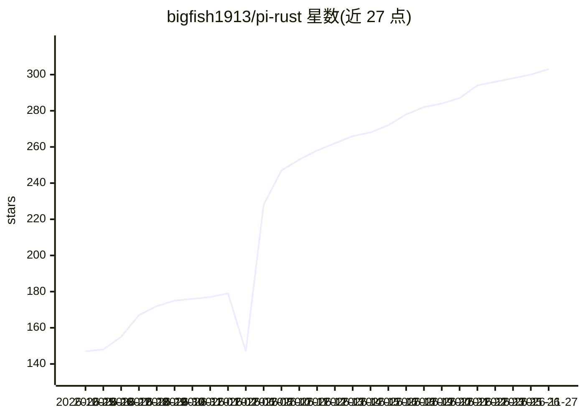

# bigfish1913/pi-rust

⭐ 303 · Rust · MIT · 推送 2026-11-26 · [GitHub](https://github.com/bigfish1913/pi-rust) · [官网](https://rpi.bigfisharc.cn/) · 个人维护

**给开发者的 Rust 编码 agent 运行时库与终端 CLI**

以 Rust 编写的 library-first 编码 agent 运行时，含终端 agent CLI，由 11 个 crate 组成：provider 适配层、可崩溃恢复的 agent 循环、可嵌入运行时、终端 UI 与稳定插件 ABI（C ABI、cdylib 插件、版本协商）。同一实现可作为嵌入式 SDK 或独立 rpi 命令使用；会话以 JSONL 持久化并在崩溃后从最近提交帧恢复；提供确定性 faux provider 支持离线测试。项目始于 Pi TypeScript SDK 的 Rust 重实现。

## 筛选速览

| 维度 | 判定 | 备注 |
|---|---|---|
| AI 角色 | `ai-ecosystem` | LLM/agent 周边工具 |
| 许可风险 | `permissive` | MIT |
| 部署形态 | `library` | 以包/库形式分发 |
| 模型依赖 | locked-api |  |
| 硬件要求 | — | 无带数字的原话,不猜 |
| 安装摩擦 | `low` | 无编译、无系统依赖或容器化 |
| 成熟度 | — | 结构信号不足 |

## 能力要点

- 11 个可组合 crate，同一实现提供 SDK 与 CLI 两种形态
- 稳定 #[repr(C)] 插件 ABI，带版本协商，插件不随编译器版本失效
- JSONL 会话持久化与崩溃恢复（从最后提交帧续跑）
- 确定性 faux provider 与内存执行环境支持离线测试

## 适用场景

- 在终端使用 TUI/一次性/JSON 模式的编码 agent
- 在自己的进程内嵌入 agent 循环（rpi-agent + rpi-ai）
- 以 rpi-plugin-sdk 编写插件扩展所有会话
- 离线确定性测试 agent 工具往返流程

## 场景标签

`编码 Agent` `Agent 框架` · 领域:Agent 开发

## 证据(README 行号)

> L15: `rpi` is a library-first coding-agent runtime written in Rust, plus a terminal
> L18: stable plugin ABI — so the same code works as an embedded SDK or as a ready-to-run
> L249: |`rpi-agent`|The agent loop: `AgentTool`, events, hooks, queues, cancellation|

## 星数曲线

2026-10-25 147 → 2026-11-27 303（+156）

---
*卡片 v1 · prompt 1.4 · 生成 2026-11-27 · 置信度 high · 依据 README sha `316960726364` · [字段定义](../../DATASET.md)*
