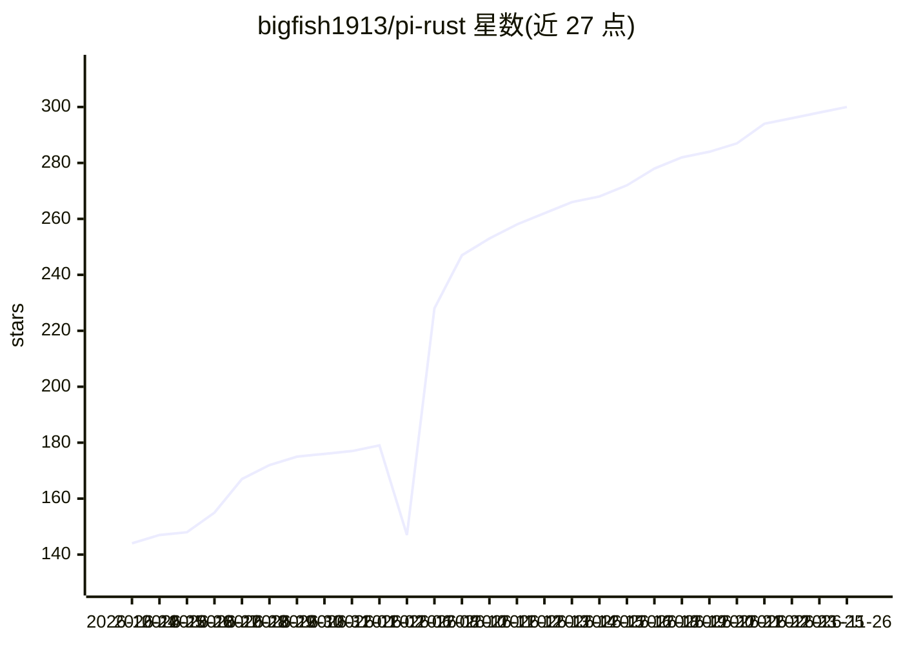

# bigfish1913/pi-rust

⭐ 300 · Rust · MIT · 推送 2026-11-25 · [GitHub](https://github.com/bigfish1913/pi-rust) · [官网](https://rpi.bigfisharc.cn/) · 个人维护

**Rust 编写的编码 agent 运行时库与终端 CLI**

以库为先的 coding-agent 运行时，含 11 个可组合 crate：provider 适配层、可崩溃恢复的 agent 循环、可嵌入 runtime、终端 UI 与稳定的插件 C ABI。同一实现可用作嵌入式 SDK（rpi-agent/rpi-ai）、终端 agent（rpi-cli）或扩展各会话的插件（rpi-plugin-sdk）。会话以 JSONL 持久化并支持崩溃恢复；内置 faux 确定性 provider 可离线测试；源自对 Pi TypeScript SDK 的 Rust 重实现。

## 筛选速览

| 维度 | 判定 | 备注 |
|---|---|---|
| AI 角色 | `ai-ecosystem` | LLM/agent 周边工具 |
| 许可风险 | `permissive` | MIT |
| 部署形态 | `library` | 以包/库形式分发 |
| 模型依赖 | locked-api |  |
| 硬件要求 | — | 无带数字的原话,不猜 |
| 安装摩擦 | `low` | 无编译、无系统依赖或容器化 |
| 成熟度 | — | 结构信号不足 |

## 能力要点

- 库与 CLI 共用一套实现：嵌入式 SDK、终端 agent、cdylib 插件三种用法
- JSONL 会话持久化与崩溃后从已提交帧恢复
- 确定性 faux provider 与内存执行环境支持离线无网络测试
- 手写 #[repr(C)] 稳定插件 ABI，带版本协商

## 适用场景

- 在自有进程中嵌入一个编码 agent 循环
- 作为终端 TUI coding agent 日常使用
- 编写 Rust cdylib 插件扩展 agent 工具集

## 场景标签

`编码 Agent` `Agent 框架` · 领域:Agent 开发

## 证据(README 行号)

> L15: `rpi` is a library-first coding-agent runtime written in Rust, plus a terminal
> L18: stable plugin ABI — so the same code works as an embedded SDK or as a ready-to-run
> L257: Most coding agents are CLIs. `rpi` is a **runtime with a CLI attached**, which

## 星数曲线

2026-10-24 144 → 2026-11-26 300（+156）

---
*卡片 v1 · prompt 1.4 · 生成 2026-11-25 · 置信度 high · 依据 README sha `d9504e11d3ff` · [字段定义](../../DATASET.md)*
