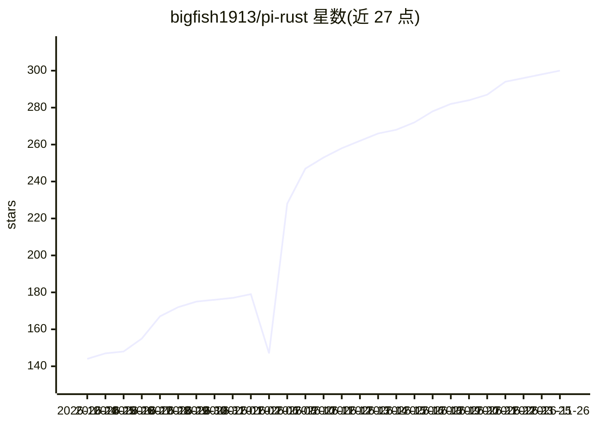

# bigfish1913/pi-rust

⭐ 300 · Rust · MIT · 推送 2026-11-25 · [GitHub](https://github.com/bigfish1913/pi-rust) · [官网](https://rpi.bigfisharc.cn/) · 个人维护

**为开发者提供 Rust 编码智能体运行时：嵌入式 SDK 与终端 CLI 双形态**

由 11 个 crate 组成的 Rust 原生编码智能体运行时，库优先设计，可嵌入进程内运行，也可作为 `rpi` 终端 CLI 使用。核心机制包括：可组合的 provider 适配层（Anthropic、OpenAI 兼容及离线 faux）、崩溃可恢复的持久 agent 循环（JSONL 会话持久化）、稳定的 C ABI 插件接口（cdylib 插件带版本协商）。工具集覆盖 read/write/edit/bash 等，支持流式超时控制与运行时诊断变量。源自 Pi TypeScript SDK 的 Rust 重实现。

## 筛选速览

| 维度 | 判定 | 备注 |
|---|---|---|
| AI 角色 | `ai-ecosystem` | LLM/agent 周边工具 |
| 许可风险 | `permissive` | MIT |
| 部署形态 | `library` | 以包/库形式分发 |
| 模型依赖 | — | README 未给出锁定关系 |
| 硬件要求 | — | 无带数字的原话,不猜 |
| 安装摩擦 | `low` | 无编译、无系统依赖或容器化 |
| 成熟度 | — | 结构信号不足 |

## 能力要点

- 库优先：agent 循环可嵌入进程内，或作为 ready-to-run CLI 使用
- 崩溃可恢复：会话持久化为 JSONL，从中断帧恢复而非重放整个 turn
- 稳定插件 ABI：手写 panic 隔离的 C ABI，带版本协商
- 确定性 faux provider 支持无网络离线测试

## 适用场景

- 在自有程序中嵌入编码 agent，无需 shell 调用与 stdout 解析
- 终端交互式编码助手（TUI、one-shot、JSON 事件流）
- 为多 session 提供工具/provider 的插件开发者

## 场景标签

`Agent 框架` `编码 Agent` · 领域:Agent 开发

## 证据(README 行号)

> L15: `rpi` is a library-first coding-agent runtime written in Rust, plus a terminal
> L263: Most coding agents are CLIs. `rpi` is a **runtime with a CLI attached**, which

## 星数曲线

2026-10-24 144 → 2026-11-26 300（+156）

---
*卡片 v1 · prompt 1.4 · 生成 2026-11-26 · 置信度 high · 依据 README sha `c25020514b1a` · [字段定义](../../DATASET.md)*
