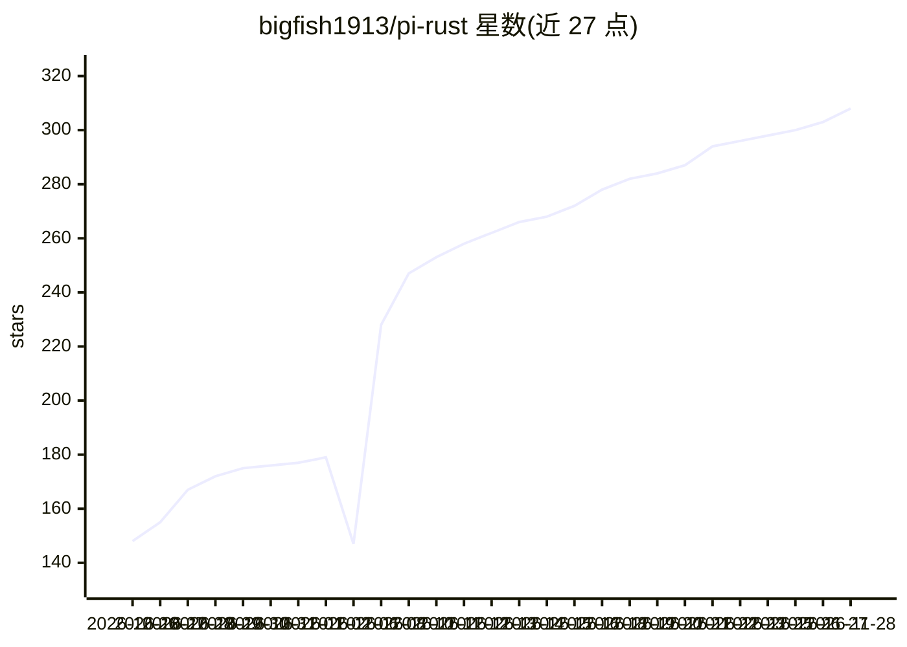

# bigfish1913/pi-rust

⭐ 308 · Rust · MIT · 推送 2026-11-27 · [GitHub](https://github.com/bigfish1913/pi-rust) · [官网](https://rpi.bigfisharc.cn/) · 个人维护

**Rust 编写的 coding-agent 运行时库与终端 CLI，面向开发者**

以库为先的 Rust coding-agent 运行时，由 11 个可组合 crate 构成：provider 适配器、可崩溃恢复的 agent 循环、可嵌入 runtime、终端 TUI 与稳定的插件 ABI。同一实现可作为嵌入式 SDK 或独立 rpi 命令使用；会话以 JSONL 持久化并支持崩溃后从最近提交帧恢复。提供二进制安装脚本、npm/crates.io/brew/scoop 分发，支持自定义 OpenAI/Anthropic 兼容网关与离线 faux provider 测试路径。

## 筛选速览

| 维度 | 判定 | 备注 |
|---|---|---|
| AI 角色 | `ai-ecosystem` | LLM/agent 周边工具 |
| 许可风险 | `permissive` | MIT |
| 部署形态 | `library` | 以包/库形式分发 |
| 模型依赖 | locked-api |  |
| 硬件要求 | — | 无带数字的原话,不猜 |
| 安装摩擦 | `low` | 无编译、无系统依赖或容器化 |
| 成熟度 | — | 结构信号不足 |

## 能力要点

- 11 个可组合 crate：provider 适配、agent 循环、TUI、插件 ABI
- JSONL 会话持久化与崩溃恢复（从最近提交帧续跑）
- 支持自定义 OpenAI/Anthropic 兼容网关与离线 faux provider
- 插件以 cdylib 形式经稳定 #[repr(C)] ABI 加载

## 适用场景

- 在终端以 TUI 或一次性命令运行 coding agent
- 在自己的 Rust 进程中嵌入 agent（rpi-agent/rpi-ai/rpi-tools）
- 开发可被全局 rpi 加载的工具或 provider 插件
- 离线运行确定性示例与测试（无需 API key）

## 场景标签

`Agent 框架` `编码 Agent` · 领域:Agent 开发

## 证据(README 行号)

> L17: `rpi` is a library-first coding-agent runtime written in Rust, plus a terminal
> L18: agent built on top of it. Eleven composable crates span provider adapters, a
> L291: |`rpi-ai`|Provider-agnostic message, streaming and tool-schema types; Anthropic + OpenAI-compatible + `faux` provi

## 星数曲线

2026-10-26 148 → 2026-11-28 308（+160）

---
*卡片 v1 · prompt 1.4 · 生成 2026-11-28 · 置信度 high · 依据 README sha `72f64de27487` · [字段定义](../../DATASET.md)*
