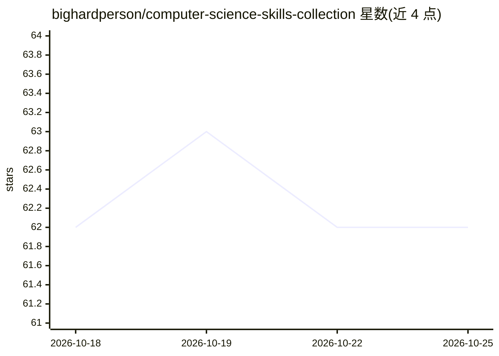

# bighardperson/computer-science-skills-collection

⭐ 62 · Python · NOASSERTION · 推送 2026-04-26 · [GitHub](https://github.com/bighardperson/computer-science-skills-collection) · 个人维护 · 中文 README

**计算机专业 Claude Code/OpenClaw 风格技能合集（610 条）**

面向计算机专业学生、开发者和 AI Agent 使用者的技能提示词库：收录 610 个 SKILL.md 格式的 skill 入口，按编程语言、前后端、云平台、AI Agent、科研、自动化、安全审计等 9 个分类组织，保留原始目录并生成总目录、分类索引与学习路线。技能条目兼容 Claude Code / Codex / OpenClaw 工作流，可通过 Release 下载、git clone 或安装脚本复制到本机 skills 目录，供二次开发与定制。

## 筛选速览

| 维度 | 判定 | 备注 |
|---|---|---|
| AI 角色 | `ai-knowledge` | 知识聚合/清单类 |
| 许可风险 | `none` | NOASSERTION |
| 部署形态 | `desktop` | 安装包/桌面程序 |
| 模型依赖 | — | README 未给出锁定关系 |
| 硬件要求 | — | 无带数字的原话,不猜 |
| 安装摩擦 | `low` | 无编译、无系统依赖或容器化 |
| 成熟度 | — | 结构信号不足 |

## 能力要点

- 收录 610 个 SKILL.md 格式的 skill 入口
- 9 个分类组织，附总目录、分类索引与学习路线
- 提供 Release 一键下载、git clone 与 install.sh 安装脚本

## 适用场景

- 为 Claude Code / OpenClaw 等 Agent 查找可复用技能模板
- 按学习路线浏览计算机专业各方向的实践技能
- 搭建个人 Agent 工具库或提示词库

## 场景标签

`精选清单` `提示工程` · 领域:Agent 开发

## 证据(README 行号)

> L10: 这是一个面向计算机专业学生、开发者和 AI Agent 使用者的 Skills 大合集。它整理了本机 Claude Code / OpenClaw 风格的 skill 库，覆盖编程语言、前后端、移动端、云服务、AI Agent、浏
> L12: 这个仓库的目标不是把资料堆在一起，而是把可复用的能力沉淀成一套可以浏览、复制、二次开发的知识库：你可以把它当成技能提示词库、AI Agent 工作流模板库，也可以把它当成计算机专业实践方向的路线图。

## 星数曲线

2026-10-18 62 → 2026-10-25 62（+0）

---
*卡片 v1 · prompt 1.4 · 生成 2026-10-24 · 置信度 high · 依据 README sha `1a7127e2fa8b` · [字段定义](../../DATASET.md)*
