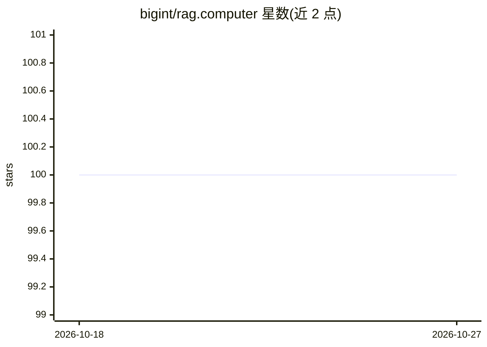

# bigint/rag.computer

⭐ 100 · Python · MIT · 推送 2026-10-04 · [GitHub](https://github.com/bigint/rag.computer) · [官网](https://rag.computer) · 个人维护

**可自托管的 RAG 平台：文档摄取、嵌入与向量检索封装为 REST API**

bigRAG 是基于 Turbopuffer 的开源自托管 RAG 平台，通过统一 REST API 提供文档摄取（Docling 支持 PDF/DOCX/HTML 等）、自动分块、嵌入（OpenAI/Cohere/Voyage/OpenAI 兼容网关）与语义/关键词/混合检索。每个 collection 映射到 Turbopuffer namespace 实现隔离；含管理 UI、范围化 API key 与审计日志、S3/R2 同步连接器、recall@k/MRR/nDCG 评测端点、Webhook、加密缓存及后端接地聊天。提供 TypeScript/Python SDK 与 MCP server。运行需配置外部 Turbopuffer 服务。

## 筛选速览

| 维度 | 判定 | 备注 |
|---|---|---|
| AI 角色 | `ai-ecosystem` | LLM/agent 周边工具 |
| 许可风险 | `permissive` | MIT |
| 部署形态 | `self-host` | docker 或自建部署 |
| 模型依赖 | locked-api |  |
| 硬件要求 | — | 无带数字的原话,不猜 |
| 安装摩擦 | `low` | 无编译、无系统依赖或容器化 |
| 成熟度 | — | 结构信号不足 |

## 能力要点

- 统一 REST API 覆盖摄取、嵌入、混合检索与批处理
- 多 embedding 供应商与可保存的命名预设配置
- 检索评测端点（recall@k / MRR / nDCG）与查询分析
- TypeScript/Python SDK 及 MCP server（8 个工具）

## 适用场景

- 自托管一套文档摄取与语义检索服务供应用调用
- 在 Claude Desktop / Cursor 中通过 MCP 检索自己的文档库
- 从 S3/R2 桶定时同步并索引文档

## 场景标签

`RAG` · 领域:知识与检索

## 证据(README 行号)

> L3: **Open-source, self-hostable RAG platform with Turbopuffer-backed search.**
> L20: - **Turbopuffer search** — vectors, chunk text, metadata filters, BM25 keyword search, and hybrid retrieval via Tur
> L35: - **Clients** — TypeScript and Python SDKs plus an MCP server for Claude Desktop, Cursor, and any MCP-aware runtime

## 星数曲线

2026-10-18 100 → 2026-10-27 100（+0）

---
*卡片 v1 · prompt 1.4 · 生成 2026-10-23 · 置信度 high · 依据 README sha `4bc835402c6d` · [字段定义](../../DATASET.md)*
