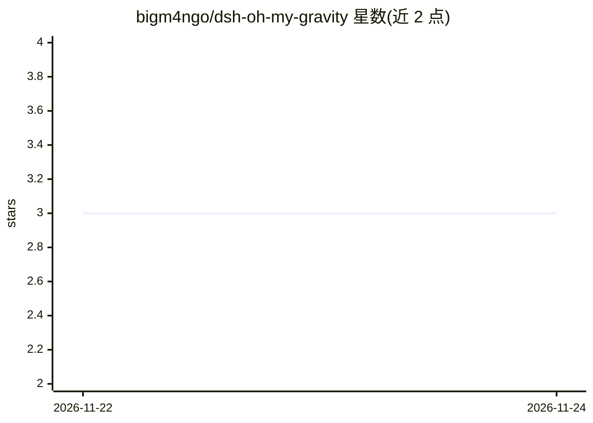

# bigm4ngo/dsh-oh-my-gravity

⭐ 4 · TypeScript · MIT · 推送 2026-11-22 · [GitHub](https://github.com/bigm4ngo/dsh-oh-my-gravity) · 个人维护

**将已登录的 Antigravity CLI 作为 DeepSeek Harness 模型提供方的插件**

一个 DSH（DeepSeek Harness）插件：通过 Agent Client Protocol 启动用户已登录的 Antigravity CLI（agy），把 AGY 的模型接入 DSH 的模型选择器，无需额外 API key。提供流式文本与推理输出、token 用量、套餐额度显示、DSH 工具行与权限审批桥接，DSH 的访问模式（只读/工作区写入/完全访问）逐轮驱动 AGY 自身的权限模式。状态为 alpha，非官方、与 Google 无关联，在 Linux 上配合 AGY 1.5.13 与 DSH 0.2.2-rc.1 测试；仅转发文本，Windows/macOS 未测试。

## 筛选速览

| 维度 | 判定 | 备注 |
|---|---|---|
| AI 角色 | `ai-ecosystem` | LLM/agent 周边工具 |
| 许可风险 | `permissive` | MIT |
| 部署形态 | `None` |  |
| 模型依赖 | — | README 未给出锁定关系 |
| 硬件要求 | — | 无带数字的原话,不猜 |
| 安装摩擦 | `low` | 无编译、无系统依赖或容器化 |
| 成熟度 | `idea` | |

## 能力要点

- 以已登录的 agy 凭据作为模型通道，无需 API key
- 通过 ACP 转发权限请求，DSH 审批服务逐条裁决
- DSH 访问模式逐轮映射到 AGY 的 sandbox 模式
- 支持流式输出、会话恢复与套餐额度显示

## 适用场景

- 在 DSH 中直接使用 AGY 已登录账号可用的模型
- 让 DSH 的审批与访问模式约束 agy 的工具调用
- 在 Linux 上为 DSH 接入额外的模型提供方

## 场景标签

`模型网关` · 领域:Agent 开发

## 证据(README 行号)

> L3: Run your signed-in Antigravity CLI (`agy`) as a model provider inside DSH: no API key, the login `agy` already has.
> L13: - DSH's tools (subagents, jobs, skills, …) available to AGY, each call approved through DSH.
> L38: DSH starts `agy acp --sandbox` per DSH session and talks to it over the Agent Client Protocol. ACP is used instead 

## 星数曲线

2026-11-22 3 → 2026-11-24 3（+0）

---
*卡片 v1 · prompt 1.4 · 生成 2026-11-22 · 置信度 high · 依据 README sha `4c05d83002a2` · [字段定义](../../DATASET.md)*
