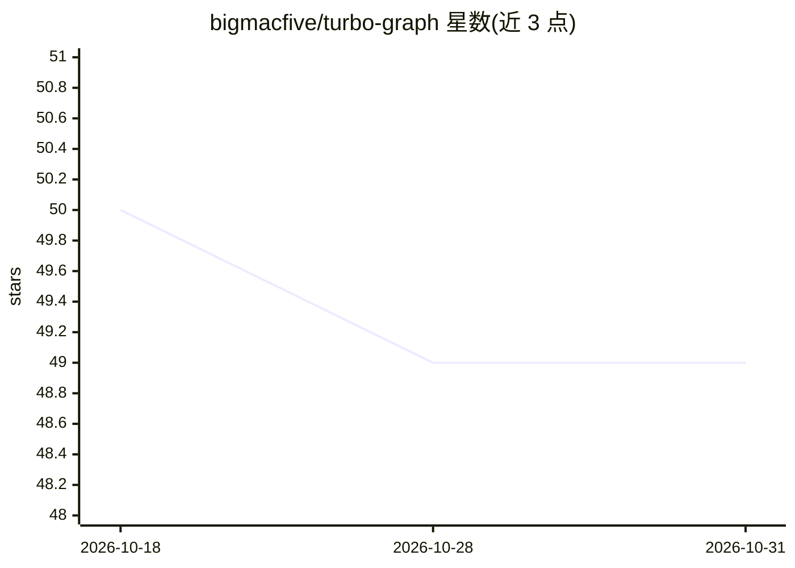

# bigmacfive/turbo-graph

⭐ 49 · Rust · MIT · 推送 2026-06-19 · [GitHub](https://github.com/bigmacfive/turbo-graph) · 个人维护

**面向受约束 RAG 的向量检索加图记忆层，供 Python/Rust 开发者**

turbovec 的 fork，保留 TurboQuant 编码/搜索核心，叠加图记忆层：支持 tenant/graph/tag/source/time/BM25 候选/向量搜索多约束交集检索，提供可缓存的 SlotMask 编译、图感知 rerank、explain/cache 遥测，以及 Python GraphMemoryIndex 与 Rust API。Python 绑定在长耗时路径释放 GIL。给需要在多约束条件下做 RAG 检索的开发者使用。限制：暴力 O(n) 扫描（非 HNSW/IVF）、2-4 bit 近似、TQ+ 首次 add 需至少 1000 向量。

## 筛选速览

| 维度 | 判定 | 备注 |
|---|---|---|
| AI 角色 | `ai-ecosystem` | LLM/agent 周边工具 |
| 许可风险 | `permissive` | MIT |
| 部署形态 | `library` | 以包/库形式分发 |
| 模型依赖 | — | README 未给出锁定关系 |
| 硬件要求 | — | 无带数字的原话,不猜 |
| 安装摩擦 | `low` | 无编译、无系统依赖或容器化 |
| 成熟度 | — | 结构信号不足 |

## 能力要点

- 多约束交集检索（tenant ∩ graph ∩ tag ∩ source ∩ time ∩ BM25 ∩ 向量）
- 可缓存 SlotMask 编译与图感知 rerank、explain/cache 遥测
- Python/Rust 双 API，Python 绑定在长耗时路径释放 GIL
- 与 turbovec 核心兼容（TurboQuantIndex/IdMapIndex）

## 适用场景

- RAG 查询带租户/来源/标签/时间等约束时直接在索引内检索
- 向量检索前需扩展图邻域再搜索的场景
- 热查询重复构建相同过滤视图时缓存复用

## 场景标签

`向量数据库` · 领域:知识与检索

## 证据(README 行号)

> L11: **turbovec made embeddings small. turbo-graph makes constrained retrieval
> L22: turbo-graph keeps the turbovec/TurboQuant core and adds:
> L79: encoding/search, `.tv` / `.tvim`, and the core Python index APIs are the same

## 星数曲线

2026-10-18 50 → 2026-10-31 49（-1）

---
*卡片 v1 · prompt 1.4 · 生成 2026-10-24 · 置信度 high · 依据 README sha `c310ef2db59b` · [字段定义](../../DATASET.md)*
