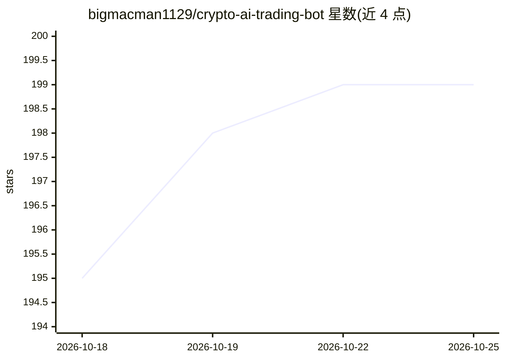

# bigmacman1129/crypto-ai-trading-bot

⭐ 199 · JavaScript · 推送 2026-08-25 · [GitHub](https://github.com/bigmacman1129/crypto-ai-trading-bot) · 个人维护

**自托管加密做市与流动性信号交易机器人（Node.js）**

基于 Node.js 的自托管加密现货交易机器人：做市（经典洗量与 Avellaneda–Stoikov 风格双边报价）、跨交易所与三角套利扫描、订单簿流动性分析（microprice、失衡、墙、缺口、扫荡）。通过 ADAMANT 信使命令控制，可选 Telegram/CLI 与本地健康 API。套利默认仅扫描告警，实盘需双所 API key 且声明为实验性；未提供经验证的历史回测。适配多个 CEX 现货交易所。

## 筛选速览

| 维度 | 判定 | 备注 |
|---|---|---|
| AI 角色 | `ai-enhanced` | 去掉 AI 部分产品仍成立 |
| 许可风险 | `none` | — |
| 部署形态 | `self-host` | docker 或自建部署 |
| 模型依赖 | — | README 未给出锁定关系 |
| 硬件要求 | — | 无带数字的原话,不猜 |
| 安装摩擦 | `low` | 无编译、无系统依赖或容器化 |
| 成熟度 | `idea` | |

## 能力要点

- 订单簿流动性信号：止损簇、缺口、墙移除、扫荡事件
- Avellaneda–Stoikov 风格双边报价与库存偏斜
- 跨交易所与三角套利扫描（默认告警模式）
- 风控引擎：最大订单、库存、名义敞口、日亏损熔断

## 适用场景

- 自托管加密做市与流动性信号交易
- 订单簿与市场微观结构量化研究
- 将流动性事件作为 AI/ML 策略的特征或触发器

## 场景标签

`金融量化` · 领域:学习与行业

## 证据(README 行号)

> L17: Most crypto trading bots rely only on **price and technical indicators**. Professional traders, however, monitor **
> L75: Order-book analytics (microprice, imbalance, walls, gaps)
> L200: - **AI/ML strategy dev** — Use liquidity events as features or triggers.

## 星数曲线

2026-10-18 195 → 2026-10-25 199（+4）

---
*卡片 v1 · prompt 1.4 · 生成 2026-10-22 · 置信度 mid · 依据 README sha `a8bb7c777cc5` · [字段定义](../../DATASET.md)*
