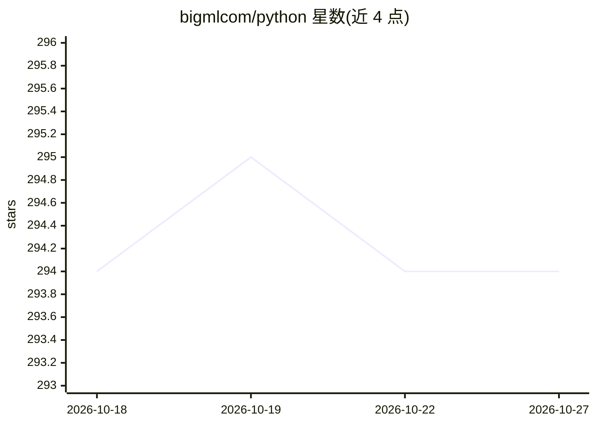

# bigmlcom/python

⭐ 294 · Python · Apache-2.0 · 推送 2026-07-24 · [GitHub](https://github.com/bigmlcom/python) · [官网](http://bigml.com/api) · 组织维护

**BigML 机器学习云服务的 Python API 绑定库**

BigML.io 官方 Python 客户端库：通过 API 创建、获取、更新、删除 BigML 平台资源（source、dataset、model、prediction），也支持用平台生成的模型做本地预测。认证基于用户名与 API key（环境变量或构造参数），支持组织/项目级权限、VPC 与预测服务器自定义域名。仅支持 Python 3；本地主题模型与图像预测需安装 extras，图像 extras 仅在 Linux 上测试支持。Apache 2.0 许可。

## 筛选速览

| 维度 | 判定 | 备注 |
|---|---|---|
| AI 角色 | `ai-ecosystem` | LLM/agent 周边工具 |
| 许可风险 | `permissive` | Apache-2.0 |
| 部署形态 | `library` | 以包/库形式分发 |
| 模型依赖 | — | README 未给出锁定关系 |
| 硬件要求 | — | 无带数字的原话,不猜 |
| 安装摩擦 | `low` | 无编译、无系统依赖或容器化 |
| 成熟度 | — | 结构信号不足 |

## 能力要点

- 对 BigML.io 资源的完整 CRUD 操作
- 基于平台模型的本地预测（部分模型类型需 extras）
- 支持组织/项目权限、VPC 与独立预测服务器域名配置
- 依赖 requests/numpy/scipy 等在安装时自动装入

## 适用场景

- 在 Python 程序中调用 BigML 云端机器学习工作流
- 上传 CSV 数据集并在平台创建模型、生成预测
- 企业组织内按项目权限管理 BigML 资源

## 场景标签

`MLOps` · 领域:训练与推理

## 证据(README 行号)

> L10: These BigML Python bindings allow you to interact with
> L51: The bindings provide support to use the ``BigML`` platform to create, update,

## 星数曲线

2026-10-18 294 → 2026-10-27 294（+0）

---
*卡片 v1 · prompt 1.4 · 生成 2026-10-21 · 置信度 high · 依据 README sha `7deab2d45c9b` · [字段定义](../../DATASET.md)*
