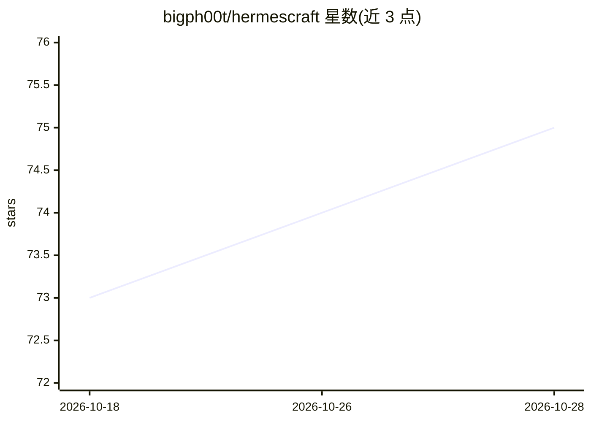

# bigph00t/hermescraft

⭐ 75 · JavaScript · MIT · 推送 2026-03-25 · [GitHub](https://github.com/bigph00t/hermescraft) · [官网](https://github.com/NousResearch/hermes-agent) · 个人维护

**Minecraft 中的具身 Hermes AI 伴侣与多智能体世界**

基于 Nous Research 的 Hermes Agent 构建的 Minecraft 具身 AI 智能体系统：每个角色是一个标准 Hermes agent，拥有独立记忆、会话、SOUL 提示词与 Mineflayer 机器人身体，通过 mc CLI 与 HTTP API 驱动在游戏世界中的移动、采集、建造、战斗与聊天。提供三种模式：单人伴侣、多智能体文明模式、5 角色 LAN 小队。采用公平感知设计（视线过滤、方向性声音、非全知扫描）。需 Node.js 18+、Python 3、Hermes CLI 与 Minecraft Java 版，运行 ./setup.sh 与各启动脚本启动。为 Nous Hermes 黑客松项目，README 自述仍处于早期完善阶段。

## 筛选速览

| 维度 | 判定 | 备注 |
|---|---|---|
| AI 角色 | `ai-native` | 本体是模型或模型工具 |
| 许可风险 | `permissive` | MIT |
| 部署形态 | `None` |  |
| 模型依赖 | — | README 未给出锁定关系 |
| 硬件要求 | — | 无带数字的原话,不猜 |
| 安装摩擦 | `low` | 无编译、无系统依赖或容器化 |
| 成熟度 | `idea` | |

## 能力要点

- 每角色独立记忆/会话/SOUL 提示词的持久身份设计
- 公平感知：视线过滤、方向性声音提示、非全知资源搜索
- 三种模式：伴侣、多智能体文明、LAN 小队
- mc CLI 提供观察/行动/截图视觉命令集

## 适用场景

- 在单人世界里带一个 AI 队友一起挖矿建造探险
- 让多个 AI 角色共存于同一服务器形成小社会
- 通过游戏内聊天用自然语言指挥智能体行动

## 场景标签

`多智能体` · 领域:Agent 开发

## 证据(README 行号)

> L10: HermesCraft lets you play Minecraft with Hermes agents as actual in-world players.
> L20: Each character is a normal Hermes agent with:
> L31: Hermes Agent

## 星数曲线

2026-10-18 73 → 2026-10-28 75（+2）

---
*卡片 v1 · prompt 1.4 · 生成 2026-10-24 · 置信度 high · 依据 README sha `ca945d9a7360` · [字段定义](../../DATASET.md)*
