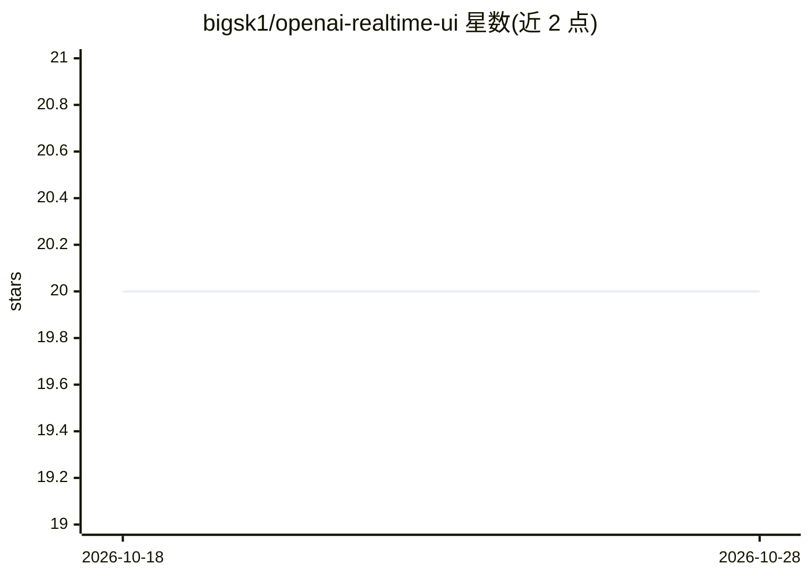

# bigsk1/openai-realtime-ui

⭐ 20 · JavaScript · MIT · 推送 2026-03-24 · [GitHub](https://github.com/bigsk1/openai-realtime-ui) · 个人维护

**与 OpenAI Realtime API 对话的 Web UI，带工具与 webhook 扩展**

基于 React 的 Web 应用，连接 OpenAI Realtime API 提供实时聊天界面。内置可扩展工具系统：Web 搜索（可选 SearXNG 实例）、调色板生成、当前日期时间查询、剪贴板管理器，以及无需编码即可配置的通用 webhook 系统，支持 API Key/Basic/Bearer/自定义头等多种认证，可让 AI 调用任意外部 API 并自动链式组合工具。外部请求经内置代理路由规避 CORS。需 Node.js v18+ 与 OpenAI API key，提供 Docker 开发环境。

## 筛选速览

| 维度 | 判定 | 备注 |
|---|---|---|
| AI 角色 | `ai-native` | 本体是模型或模型工具 |
| 许可风险 | `permissive` | MIT |
| 部署形态 | `self-host` | docker 或自建部署 |
| 模型依赖 | — | README 未给出锁定关系 |
| 硬件要求 | — | 无带数字的原话,不猜 |
| 安装摩擦 | `low` | 无编译、无系统依赖或容器化 |
| 成熟度 | — | 结构信号不足 |

## 能力要点

- 可视化配置的通用 webhook 系统，支持多种认证方式连接任意外部 API
- 可扩展工具系统：Web 搜索、调色板、日期时间、剪贴板管理
- 外部 API 请求自动经内置代理路由规避 CORS
- AI 可自动链式调用多个工具

## 适用场景

- 通过网页界面与 OpenAI 实时模型语音/文字对话
- 不写代码就让 AI 调用自己配置的外部 API
- 会话中收集、保存和组织信息片段

## 场景标签

`语音 Agent` · 领域:对话与助手

## 证据(README 行号)

> L3: A feature-rich web application for interacting with OpenAI's Realtime API, featuring a flexible tools system and uni
> L9: - 💬 Real-time chat interface with OpenAI's latest models
> L24: - An OpenAI API key with access to the Realtime API

## 星数曲线

2026-10-18 20 → 2026-10-28 20（+0）

---
*卡片 v1 · prompt 1.4 · 生成 2026-10-28 · 置信度 high · 依据 README sha `55157e73e250` · [字段定义](../../DATASET.md)*
