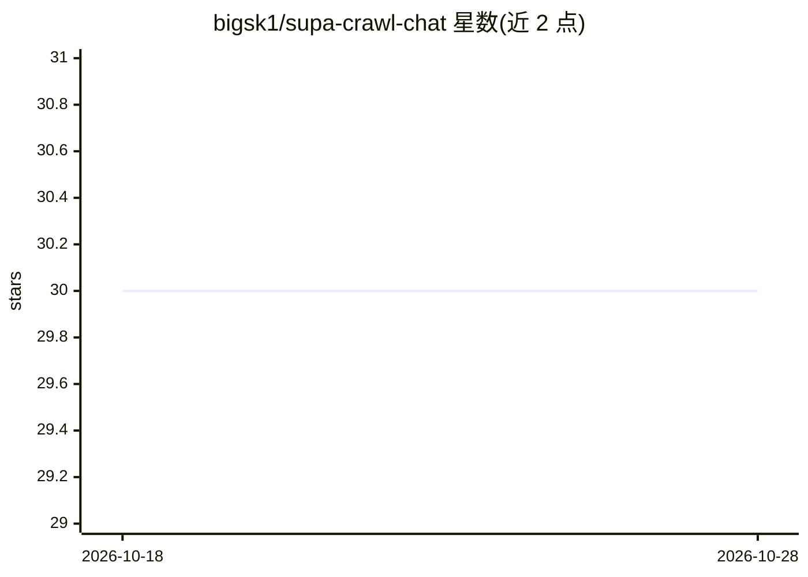

# bigsk1/supa-crawl-chat

⭐ 30 · Python · MIT · 推送 2026-10-23 · [GitHub](https://github.com/bigsk1/supa-crawl-chat) · [官网](https://github.com/bigsk1/supa-crawl-chat/wiki/Supa-%E2%80%90-Crawl-%E2%80%90-Chat-Wiki) · 个人维护

**网页爬取+语义搜索+AI 聊天一体化方案（Supabase+Crawl4AI）**

Python 应用，整合 Crawl4AI 爬取网站与 sitemap、Supabase(pgvector/Postgres) 存储，将内容按语义边界分块并用 OpenAI embeddings 生成向量，提供语义/文本双路搜索、带长期记忆的 AI 聊天、自动生成标题摘要与内容分类。后端 FastAPI（含 OpenAPI 文档、可选 API Key/JWT 鉴权、SSRF 校验），前端 Node/Vite，另带 Streamlit 数据可视化。给需要自建爬取-检索-问答系统的开发者，需 OpenAI API key，支持三种 Docker 部署组合。

## 筛选速览

| 维度 | 判定 | 备注 |
|---|---|---|
| AI 角色 | `ai-native` | 本体是模型或模型工具 |
| 许可风险 | `permissive` | MIT |
| 部署形态 | `self-host` | docker 或自建部署 |
| 模型依赖 | — | README 未给出锁定关系 |
| 硬件要求 | — | 无带数字的原话,不猜 |
| 安装摩擦 | `low` | 无编译、无系统依赖或容器化 |
| 成熟度 | — | 结构信号不足 |

## 能力要点

- Crawl4AI 爬取 URL/sitemap，处理 JS 渲染页面
- 语义分块（标题/段落边界+token 限制+重叠），pgvector 向量检索与文本检索双模式
- AI 聊天带长期记忆，对话中自动记录用户偏好
- REST API + Web UI + Streamlit 可视化，三种 Docker 部署形态

## 适用场景

- 爬取自己或团队的网站文档并建立语义搜索
- 对已爬内容做带记忆的 AI 问答（chat with your docs）
- 通过 CLI/API 批量爬取、更新与检索内容

## 场景标签

`网页抓取` `语义搜索` `文档问答` · 领域:效率与自动化

## 证据(README 行号)

> L9: Seamlessly crawl websites, transform content into vector embeddings, and enable advanced semantic search. Supa-Crawl
> L21:  - Leverage cutting-edge vector similarity and OpenAI embeddings for context-aware search capabilities
> L52: - OpenAI API key for generating embeddings, content summaries and chat

## 星数曲线

2026-10-18 30 → 2026-10-28 30（+0）

---
*卡片 v1 · prompt 1.4 · 生成 2026-10-26 · 置信度 mid · 依据 README sha `fe5ce6af9348` · [字段定义](../../DATASET.md)*
