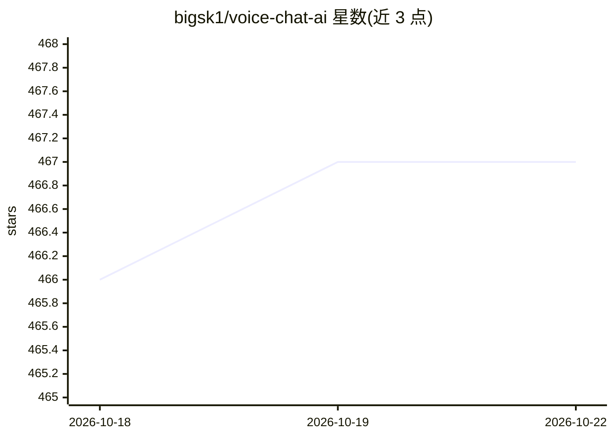

# bigsk1/voice-chat-ai

⭐ 467 · Python · MIT · 推送 2026-10-20 · [GitHub](https://github.com/bigsk1/voice-chat-ai) · 个人维护

**本地/云端皆可的语音对话 AI 应用，与多个 AI 角色用语音交流**

面向终端用户的语音对话应用：用户与预置 AI 角色（如爱因斯坦、电影 HER 的 OS）进行语音对话，可运行 Web UI 或 CLI。聊天模型支持 OpenAI、xAI、Anthropic、Ollama（可全本地运行）；语音合成支持 Spark-TTS（本地零样本克隆）、OpenAI TTS（含 gpt-4o-mini-tts 与 WebRTC 实时对话）、ElevenLabs、Kokoro、Typecast、Speechify、xAI 等。转写默认用 OpenAI，可选本地 Faster Whisper。另含情感分析与 15+ 种互动游戏/故事模式。安装途径为 pip + git clone 源码或 Docker，README 明确推荐原生安装（麦克风与音频体验），ffmpeg 为必需系统依赖。

## 筛选速览

| 维度 | 判定 | 备注 |
|---|---|---|
| AI 角色 | `ai-native` | 本体是模型或模型工具 |
| 许可风险 | `permissive` | MIT |
| 部署形态 | `self-host` | docker 或自建部署 |
| 模型依赖 | local-ok | 支持本地模型 |
| 硬件要求 | `cpu-ok` | |
| 安装摩擦 | `low` | 无编译、无系统依赖或容器化 |
| 成熟度 | — | 结构信号不足 |

## 能力要点

- 聊天模型支持 OpenAI/xAI/Anthropic/Ollama，可全本地运行
- TTS 支持 Spark-TTS（本地零样本克隆）、OpenAI、ElevenLabs、Kokoro、Typecast、Speechify、xAI 等
- OpenAI WebRTC Realtime API 实时可打断对话
- 15+ 种互动游戏与故事模式，内置大量 AI 角色
- 提供 Web UI 与 CLI 两种使用方式

## 适用场景

- 与不同性格的 AI 角色进行语音对话或角色扮演
- 用 Ollama + 本地 TTS 搭建完全离线的语音对话伙伴
- 体验 OpenAI 实时语音对话（可打断、带情感）
- 玩 AI 主持的文字解谜、密室逃脱等互动游戏

## 场景标签

`语音 Agent` `聊天机器人` · 领域:对话与助手

## 证据(README 行号)

> L6: Voice Chat AI is a project that allows you to interact with different AI characters using speech. You can choose bet
> L8: You can run all locally, you can use openai for chat and voice, you can mix between the two. You can use ElevenLabs 
> L34: - **Supports OpenAI, xAI, Anthropic or Ollama language models**: Choose the model that best fits your needs.

## 星数曲线

2026-10-18 466 → 2026-10-22 467（+1）

---
*卡片 v1 · prompt 1.4 · 生成 2026-10-22 · 置信度 mid · 依据 README sha `2f72905ceeed` · [字段定义](../../DATASET.md)*
