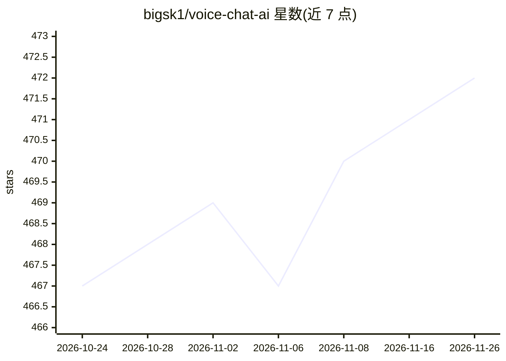

# bigsk1/voice-chat-ai

⭐ 472 · Python · MIT · 推送 2026-11-16 · [GitHub](https://github.com/bigsk1/voice-chat-ai) · 个人维护

**本地自托管的 AI 角色语音对话应用，支持多 LLM 与多 TTS**

基于 FastAPI 的 Web 应用：用户通过麦克风与不同性格/声音的 AI 角色语音对话，聊天可接 OpenAI、xAI、Anthropic 或 Ollama，语音合成可接 Spark-TTS（本地零样本声音克隆）、OpenAI TTS、ElevenLabs、Kokoro、Typecast、Speechify、xAI TTS，转写默认 OpenAI、可选本地 Faster Whisper；另含情绪分析调整回复、15+ 互动游戏与故事模式、Web UI 与 CLI 两种用法。支持 Docker（含 CUDA 镜像），README 建议实时语音场景原生安装。

## 筛选速览

| 维度 | 判定 | 备注 |
|---|---|---|
| AI 角色 | `ai-native` | 本体是模型或模型工具 |
| 许可风险 | `permissive` | MIT |
| 部署形态 | `self-host` | docker 或自建部署 |
| 模型依赖 | local-ok | 支持本地模型 |
| 硬件要求 | `cpu-ok` | |
| 安装摩擦 | `low` | 无编译、无系统依赖或容器化 |
| 成熟度 | — | 结构信号不足 |

## 能力要点

- 聊天与语音提供方可任意混搭（如 ElevenLabs 声音配 Ollama 模型）
- Spark-TTS 本地零样本声音克隆，可用自定义 .wav 样本
- OpenAI WebRTC Realtime API 实时对话，可随时打断
- 15+ 互动游戏类型与沉浸式故事模式

## 适用场景

- 本地部署与 AI 角色进行语音聊天
- 玩由 AI 主持的密室/文字游戏与互动故事
- 用本地模型（Ollama）+ 本地 TTS 实现离线语音对话
- 用自定义声音样本做语音克隆角色

## 场景标签

`语音 Agent` `语音合成` · 领域:对话与助手

## 证据(README 行号)

> L6: Voice Chat AI is a project that allows you to interact with different AI characters using speech. You can choose bet
> L34: - **Supports OpenAI, xAI, Anthropic or Ollama language models**: Choose the model that best fits your needs.
> L35: - **Provides text-to-speech synthesis using Spark-TTS or OpenAI TTS or ElevenLabs or Kokoro TTS or Typecast or Spee

## 星数曲线

2026-10-24 467 → 2026-11-26 472（+5）

---
*卡片 v1 · prompt 1.4 · 生成 2026-11-25 · 置信度 high · 依据 README sha `ee03277e44c3` · [字段定义](../../DATASET.md)*
