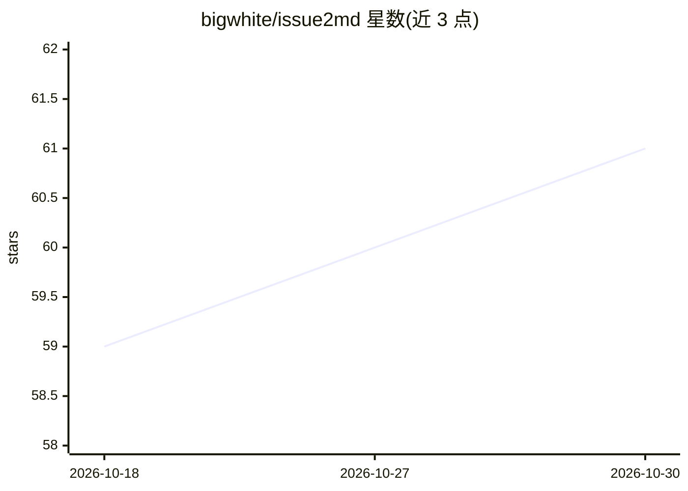

# bigwhite/issue2md

⭐ 61 · Go · Apache-2.0 · 推送 2026-07-01 · [GitHub](https://github.com/bigwhite/issue2md) · [官网](https://issue2md.tonybai.com) · 个人维护 · 中文 README

**将 GitHub issue/讨论/PR 转为 Markdown 的 CLI 与 Web 工具**

用 Go 编写的转换工具，提供命令行与 Web 两种使用方式：输入 GitHub issue、discussion 或 pull request 的 URL，输出 Markdown 格式文件。CLI 通过 go install 安装；Web 模式可用 Docker 运行（推荐）或从源码编译（git clone + make web），在浏览器 localhost:8080 中粘贴 URL 点击转换。README 注明仓库大部分内容由 AI 生成，但工具本身不涉及模型调用。

## 筛选速览

| 维度 | 判定 | 备注 |
|---|---|---|
| AI 角色 | `ai-enhanced` | 去掉 AI 部分产品仍成立 |
| 许可风险 | `permissive` | Apache-2.0 |
| 部署形态 | `self-host` | docker 或自建部署 |
| 模型依赖 | — | README 未给出锁定关系 |
| 硬件要求 | — | 无带数字的原话,不猜 |
| 安装摩擦 | `low` | 无编译、无系统依赖或容器化 |
| 成熟度 | — | 结构信号不足 |

## 能力要点

- 支持 issue/discussion/pull request 三种对象的 Markdown 转换
- CLI 与 Web 两种模式，Web 提供 Docker 镜像运行方式
- go install 一条命令安装 CLI

## 适用场景

- 把 GitHub 讨论内容存档为 Markdown 文档
- 将 issue 或 PR 内容导入知识库/笔记系统
- 在浏览器中快速转换并查看转换结果

## 场景标签

 · 领域:开发者工具/文档转换

## 证据(README 行号)

> L3: A CLI and web tool to convert GitHub issues, discussions, or pull requests into Markdown format.
> L7: >The majority of the content in this repository was generated by AI.

## 星数曲线

2026-10-18 59 → 2026-10-30 61（+2）

---
*卡片 v1 · prompt 1.4 · 生成 2026-10-24 · 置信度 low · 依据 README sha `f8d8db57c56f` · [字段定义](../../DATASET.md)*
