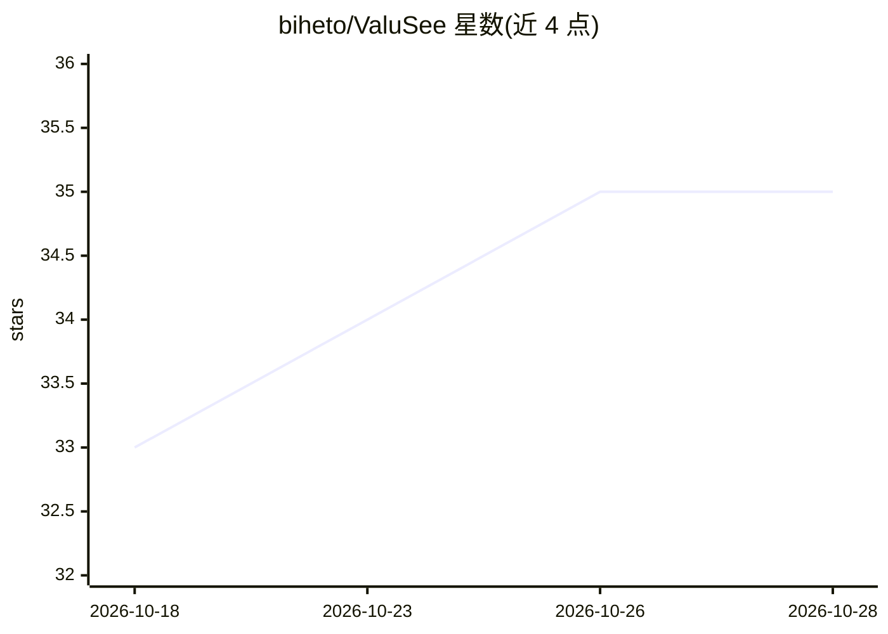

# biheto/ValuSee

⭐ 35 · Python · MIT · 推送 2026-10-19 · [GitHub](https://github.com/biheto/ValuSee) · [官网](https://valusee.com) · 个人维护 · 中文 README

**面向消费者的 AI 购物决策平台：核验同款、核算到手价、监控降价**

自托管的 AI 购物决策与省钱平台，面向消费者。用户提交商品链接、截图或自然语言需求，系统经多 Agent 工作流（Intent/Product/SKU 匹配/价格/评论/风险/推荐/监督/报告）核对候选是否为同款 SKU、拆解优惠算出真实到手价、结合预算与已有设备生成建议，并提供目标价监控、保价/退货/保修期限管理等买后功能。价格计算与硬约束由确定性代码层验证，LLM 不自行计算金额；智能对比必须使用用户自己配置的 OpenAI 兼容服务。技术栈为 React/Vite/PWA 前端与 FastAPI/LangGraph 后端，附 Manifest V3 浏览器扩展；不支持自动下单，未授权数据源保持空结果。

## 筛选速览

| 维度 | 判定 | 备注 |
|---|---|---|
| AI 角色 | `ai-native` | 本体是模型或模型工具 |
| 许可风险 | `permissive` | MIT |
| 部署形态 | `self-host` | docker 或自建部署 |
| 模型依赖 | — | README 未给出锁定关系 |
| 硬件要求 | — | 无带数字的原话,不猜 |
| 安装摩擦 | `low` | 无编译、无系统依赖或容器化 |
| 成熟度 | — | 结构信号不足 |

## 能力要点

- SKU 级同款匹配：核对品牌、型号、代次、容量、地区版本、成色等维度
- 多 Agent 购物工作流，金额/日期/硬约束由确定性代码层复核
- 用户自带 OpenAI 兼容文本/视觉模型，密钥加密存储，不回退平台 Key
- Manifest V3 浏览器扩展采集页面可见信息，两次人工确认后进入可信价格历史

## 适用场景

- 比较多个平台候选商品是否真为同款并算清到手价
- 为目标 SKU 设置降价监控并管理保价、退货、保修期限
- 结合预算和已有设备获得可解释的购买或等待建议

## 场景标签

`多智能体` · 领域:Agent 开发

## 证据(README 行号)

> L7:  把商品链接、截图或购买需求交给 AI，分清是不是同款，算清真实到手价，判断适不适合你，并持续跟进降价、保价和售后期限。
> L18: ValuSee 不是另一个只把商品按标价排序的比价器。它面向一次真实购买中最麻烦的那些问题：相似标题背后是不是同一个 SKU，优惠叠加后究竟要付多少钱，最低价是否暗藏版本和售后风险，以及这个商品是否真的适合当前用户。
> L352: ValuSee is an AI shopping decision and savings assistant. Give it product links, screenshots, or a buying need, an

## 星数曲线

2026-10-18 33 → 2026-10-28 35（+2）

---
*卡片 v1 · prompt 1.4 · 生成 2026-10-25 · 置信度 high · 依据 README sha `6e8715b776f3` · [字段定义](../../DATASET.md)*
