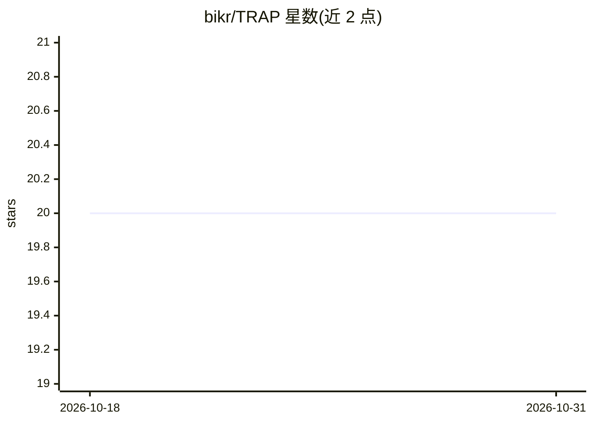

# bikr/TRAP

⭐ 20 · MIT · 推送 2026-07-21 · [GitHub](https://github.com/bikr/TRAP) · 个人维护

**让 AI 编码助手执行对抗式安全与上线就绪审计的提示词**

TRAP 是一个可复制粘贴的单一提示词，将 Claude Code、Cursor、Copilot 等编码助手配置为多人对抗式评审团，对用户自有代码库执行 11 阶段的生产就绪审计：系统建模、威胁建模、OWASP 安全评审、隐私合规、失效测试、攻击模式、性能、代码质量、仓库外控制项、发布清单与自动化工具交叉核对。核心机制是证据优先：每条结论须标注 VERIFIED/NOT PRESENT/UNKNOWN 三种裁决并引用 file:line；无仓库访问则拒绝审计（Rule 0）；输出包含字母评级、发现表、修复路线图与可复现的验证附录。限制：不保证捕获业务逻辑缺陷与运行时问题，合规场景仍需人工审计。另提供 Claude Code Agent Skill 形式自动触发安装。

## 筛选速览

| 维度 | 判定 | 备注 |
|---|---|---|
| AI 角色 | `ai-knowledge` | 知识聚合/清单类 |
| 许可风险 | `permissive` | MIT |
| 部署形态 | `None` |  |
| 模型依赖 | locked-api |  |
| 硬件要求 | — | 无带数字的原话,不猜 |
| 安装摩擦 | `low` | 无编译、无系统依赖或容器化 |
| 成熟度 | — | 结构信号不足 |

## 能力要点

- 11 阶段审计流程，覆盖 OWASP Top 10、隐私合规、攻击模式与发布清单
- 三态裁决（VERIFIED/NOT PRESENT/UNKNOWN）+ file:line 证据引用
- Rule 0：无仓库真实访问即拒绝审计
- 可安装为 Claude Code Agent Skill 自动触发

## 适用场景

- AI 快速构建的应用上线前做安全与就绪审计
- 让 Claude Code/Cursor 对自有代码库产出带证据引用的发现表与修复路线图
- 对照 npm audit/gitleaks/CodeQL 交叉核对手动审计结果

## 场景标签

`提示工程` `代码审查` `网络安全` · 领域:Agent 开发

## 证据(README 行号)

> L24: TRAP is a single, copy-pasteable prompt that reprograms your AI coding assistant into a **10-person adversarial rev
> L64: 2. **Copy** the full prompt from **`TRAP.md`** — everything below the divider.

## 星数曲线

2026-10-18 20 → 2026-10-31 20（+0）

---
*卡片 v1 · prompt 1.4 · 生成 2026-10-28 · 置信度 high · 依据 README sha `e96edb3e5906` · [字段定义](../../DATASET.md)*
