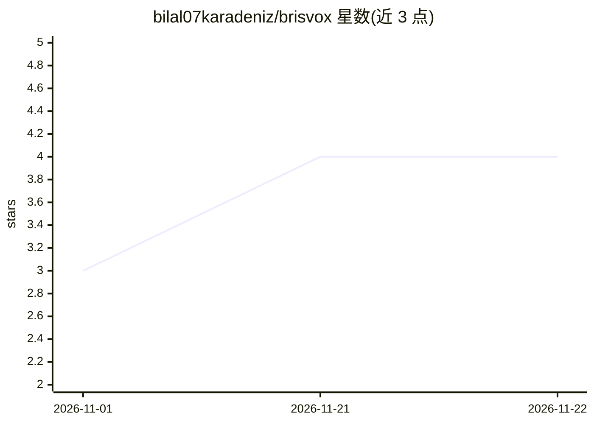

# bilal07karadeniz/brisvox

⭐ 4 · Rust · Apache-2.0 · 推送 2026-11-18 · [GitHub](https://github.com/bilal07karadeniz/brisvox) · 个人维护

**Rust 实时语音代理引擎：电话/浏览器通话中接入 LLM 语音应答**

以单进程承载大量隔离通话会话的语音代理引擎：来电经 Twilio、Telnyx、SIP、WebRTC 或 WebSocket 传输接入，每路通话独立运行 VAD 与轮次检测、STT、带工具的 LLM、TTS，模型通过共享推理池调用，提供商可为云端或本地；每路通话隔离，单个 panic 不影响其他通话。开发者用 Python 或 TypeScript（PyPI/npm SDK）或 Rust 编写 agent 与工具；带编号 epoch 丢弃过期帧、barge-in 后上下文只保留已播放文本、副作用工具不重复执行等机制，并有确定性仿真测试。

## 筛选速览

| 维度 | 判定 | 备注 |
|---|---|---|
| AI 角色 | `ai-ecosystem` | LLM/agent 周边工具 |
| 许可风险 | `permissive` | Apache-2.0 |
| 部署形态 | `desktop` | 安装包/桌面程序 |
| 模型依赖 | local-ok | 支持本地模型 |
| 硬件要求 | — | 无带数字的原话,不猜 |
| 安装摩擦 | `low` | 无编译、无系统依赖或容器化 |
| 成熟度 | — | 结构信号不足 |

## 能力要点

- 单容器承载数百路隔离通话（基准中 4 vCPU/4GB 达 250 并发）
- 编号 epoch 机制丢弃过期帧，barge-in 后 LLM 上下文只含已播放文本
- 副作用工具不投机执行、不重复执行，附幂等键说明与确定性仿真验证
- 基准数据文件提交于 bench/results/，图表由脚本生成并可校验

## 适用场景

- 构建可随时打断的电话语音代理（Twilio/Telnyx/SIP）
- 浏览器端 WebRTC 实时语音助手
- 在单容器内高密度承载大量并发语音会话

## 场景标签

`语音 Agent` · 领域:对话与助手

## 证据(README 行号)

> L16:  brisvox architecture: callers reach one brisvox-server process through Twilio, Telnyx, SIP, WebRTC or WebSocket tr
> L24: Built to beat Pipecat on three axes with the same speech and language providers: latency, density

## 星数曲线

2026-11-01 3 → 2026-11-22 4（+1）

---
*卡片 v1 · prompt 1.4 · 生成 2026-11-21 · 置信度 mid · 依据 README sha `4696c41cfaa0` · [字段定义](../../DATASET.md)*
