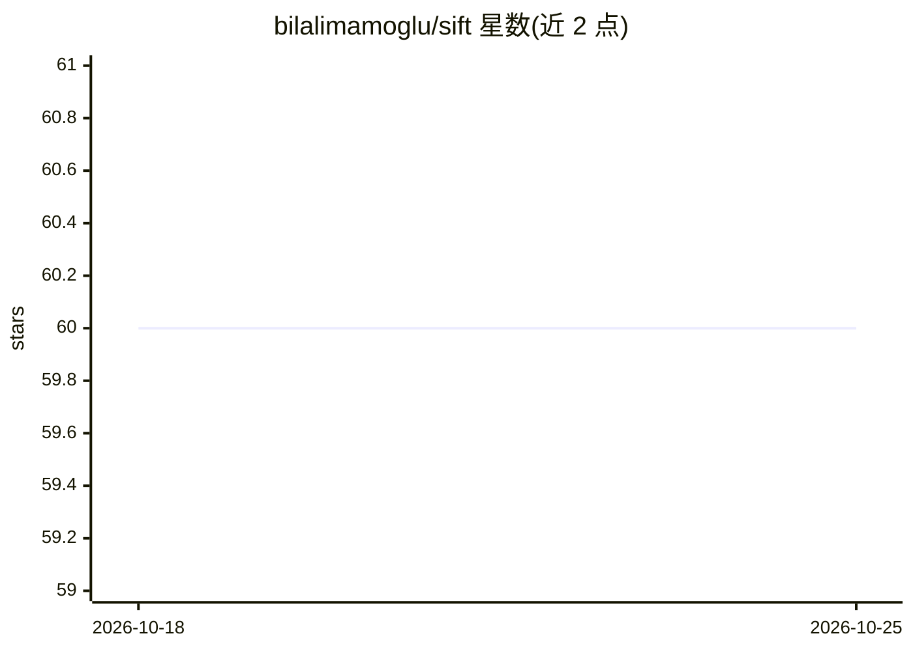

# bilalimamoglu/sift

⭐ 60 · TypeScript · MIT · 推送 2026-04-06 · [GitHub](https://github.com/bilalimamoglu/sift) · [官网](https://www.npmjs.com/package/@bilalimamoglu/sift) · 个人维护

**为编码 agent 精简嘈杂命令输出的本地启发式分层工具**

面向编码 agent 工作流的 CLI 工具：以本地启发式规则优先解析 pytest/vitest/jest、tsc、ESLint、构建工具、npm audit、terraform plan 等命令输出，把重复失败归组为可能的根因与下一步建议，供 agent 在读取完整日志前获得短的首轮摘要；启发式不足时可回退到 OpenAI/OpenRouter 兼容的廉价模型，或纯本地运行。提供 9 个预设、exec/pipe/rerun 模式及 Codex/Claude/Cursor 集成文件，需 Node.js 20+，npm 全局安装。限制：对短而明显的失败收益有限，不支持交互式/TUI 命令。

## 筛选速览

| 维度 | 判定 | 备注 |
|---|---|---|
| AI 角色 | `ai-ecosystem` | LLM/agent 周边工具 |
| 许可风险 | `permissive` | MIT |
| 部署形态 | `library` | 以包/库形式分发 |
| 模型依赖 | — | README 未给出锁定关系 |
| 硬件要求 | — | 无带数字的原话,不猜 |
| 安装摩擦 | `low` | 无编译、无系统依赖或容器化 |
| 成熟度 | — | 结构信号不足 |

## 能力要点

- 9 个预设覆盖测试失败、类型检查、lint、构建、审计与基础设施风险
- 启发式优先，多数预设无需 API key，输出确定性
- 启发式不足时可回退 OpenAI/OpenRouter 兼容端点
- 生成 Codex/Claude/Cursor 的集成指导文件（AGENTS.md/CLAUDE.md/SKILL.md）

## 适用场景

- 让编码 agent 先读归组后的测试失败摘要而非原始日志
- 在 CI 或 hooks 中把长输出压缩为短的首轮结论
- 用便宜的回退模型处理启发式无法解释的输出

## 场景标签

 · 领域:开发者工具/编码 agent 基础设施

## 证据(README 行号)

> L26: `sift` narrows that output locally first. It groups repeated failures, surfaces likely root causes, and points to t
> L133: Use `sift` in Codex, Claude, CI, hooks, or shell scripts when you want downstream tooling to receive a short first

## 星数曲线

2026-10-18 60 → 2026-10-25 60（+0）

---
*卡片 v1 · prompt 1.4 · 生成 2026-10-24 · 置信度 high · 依据 README sha `e707604f2d3f` · [字段定义](../../DATASET.md)*
