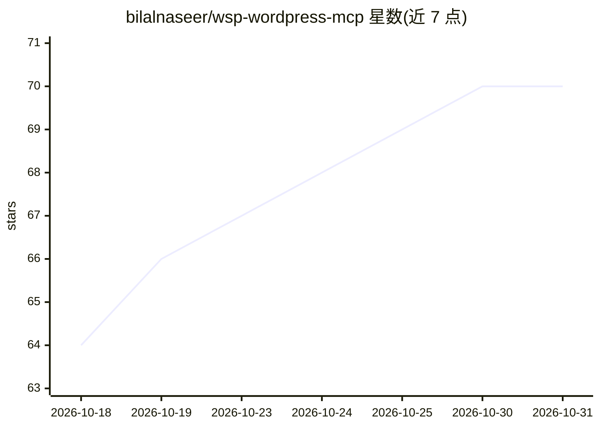

# bilalnaseer/wsp-wordpress-mcp

⭐ 70 · PHP · GPL-2.0 · 推送 2026-10-29 · [GitHub](https://github.com/bilalnaseer/wsp-wordpress-mcp) · [官网](https://wspmcp.com) · 组织维护

**让 AI 编码助手通过 MCP 直接读写 WordPress 站点的插件**

WordPress 的 MCP 服务端插件：安装启用后，Claude、ChatGPT、Cursor 等 MCP 客户端可按 WordPress 用户权限读取和修改站点内容。提供 200+ 工具，覆盖文章/页面、媒体、菜单、主题与插件管理、用户、自定义文章类型，以及 WooCommerce（34 个工具）、Yoast/Rank Math SEO、Elementor 及 UAE 页面构建器操作。安全机制为写入工具默认关闭、逐工具权限声明、按对象的所有权校验、OAuth 2.1/应用密码/API key 三种认证与审计日志。要求 WordPress 6.9+、PHP 7.4+；Claude Desktop 与 OpenClaw 需 Node.js 18+ 的 mcp-remote 桥接。由 WebSensePro（WordPress 代理机构）维护，声明全功能免费无付费版。

## 筛选速览

| 维度 | 判定 | 备注 |
|---|---|---|
| AI 角色 | `ai-ecosystem` | LLM/agent 周边工具 |
| 许可风险 | `viral` | GPL-2.0 |
| 部署形态 | `None` |  |
| 模型依赖 | locked-api |  |
| 硬件要求 | — | 无带数字的原话,不猜 |
| 安装摩擦 | `low` | 无编译、无系统依赖或容器化 |
| 成熟度 | — | 结构信号不足 |

## 能力要点

- 200+ MCP 工具，覆盖核心 WordPress、WooCommerce、SEO 与 Elementor 操作
- 逐工具权限声明与按对象所有权校验，AI 仅能执行其 WordPress 账号可做的操作
- 写入能力默认关闭，支持 OAuth 2.1 / Application Passwords / API key 三种认证
- 全部 tools/call 写入审计日志（用户、IP、结果、时长），90 天自动清理

## 适用场景

- 用 Claude 或 Cursor 等编码助手在对话中写文章、改页面、管理 WooCommerce 订单
- 让 AI 批量检查并补全 SEO meta 信息
- 在受控权限下让 agent 管理主题、插件与导航菜单

## 场景标签

 · 领域:CMS/建站工具

## 证据(README 行号)

> L11: WSP MCP is a **free MCP plugin for WordPress**. Install it, connect your AI app, and just ask:
> L26: > **What is MCP?** The Model Context Protocol is the standard way AI assistants connect to other apps. Once your si

## 星数曲线

2026-10-18 64 → 2026-10-31 70（+6）

---
*卡片 v1 · prompt 1.4 · 生成 2026-10-24 · 置信度 high · 依据 README sha `725b401876f5` · [字段定义](../../DATASET.md)*
