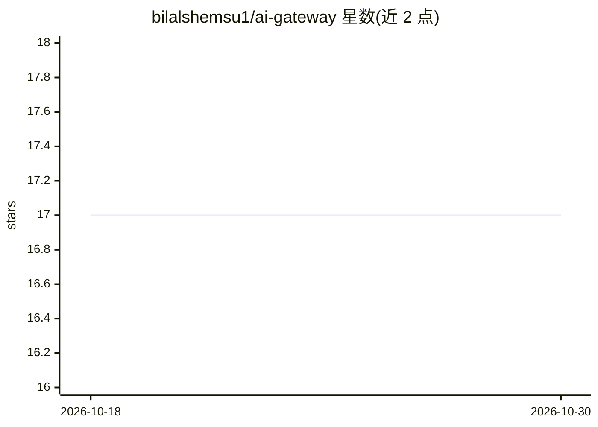

# bilalshemsu1/ai-gateway

⭐ 17 · JavaScript · ISC · 推送 2026-10-23 · [GitHub](https://github.com/bilalshemsu1/ai-gateway) · 个人维护

**多 AI 供应商的统一网关：一个 API 聚合多家免费服务**

自托管的 AI 编排服务，将 Gemini、Groq、Mistral、OpenRouter、Nvidia、Cloudflare Workers AI 等多家供应商聚合到单一 OpenAI 兼容 API 后面。提供 Token 认证、按 IP 限流（15 请求/分钟）、跨供应商自动故障转移与负载均衡。以源码克隆加环境变量配置方式部署，运行后通过 /v1/chat/completions 端点调用。给需要统一接入多家免费 AI 服务的开发者使用，不含本地模型运行时。

## 筛选速览

| 维度 | 判定 | 备注 |
|---|---|---|
| AI 角色 | `ai-ecosystem` | LLM/agent 周边工具 |
| 许可风险 | `permissive` | ISC |
| 部署形态 | `None` |  |
| 模型依赖 | locked-api |  |
| 硬件要求 | — | 无带数字的原话,不猜 |
| 安装摩擦 | `low` | 无编译、无系统依赖或容器化 |
| 成熟度 | — | 结构信号不足 |

## 能力要点

- 聚合 9 家 AI 供应商，单一 OpenAI 兼容 API
- 供应商失败时自动故障转移与负载均衡
- Token 认证与按 IP 限流（15 请求/分钟）
- 附各供应商免费额度对照表

## 适用场景

- 用一个统一端点接入多家免费 AI 供应商
- 在供应商故障时自动切换保持服务可用
- 以 OpenAI 兼容格式替换现有客户端的后端

## 场景标签

`模型网关` · 领域:Agent 开发

## 证据(README 行号)

> L3: Open-source AI orchestration service. One API, multiple AI providers.
> L12: - OpenAI-compatible API format

## 星数曲线

2026-10-18 17 → 2026-10-30 17（+0）

---
*卡片 v1 · prompt 1.4 · 生成 2026-10-29 · 置信度 high · 依据 README sha `6b23f0b640e0` · [字段定义](../../DATASET.md)*
