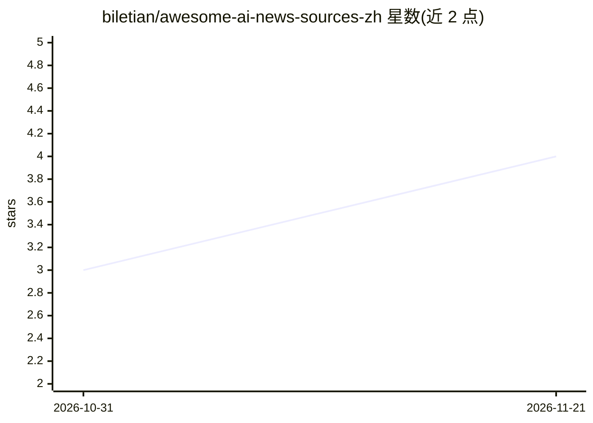

# biletian/awesome-ai-news-sources-zh

⭐ 4 · Python · CC0-1.0 · 推送 2026-11-02 · [GitHub](https://github.com/biletian/awesome-ai-news-sources-zh) · [官网](https://zhiyike.cn) · 个人维护 · 中文 README

**给 AI 从业者的每日必读 AI 资讯信源清单（176 个，中英双语）**

由知一刻（Zhiyike）维护的 awesome 类信源清单，收录 176 个 AI 资讯来源，按官方博客/模型厂商、X 账号、中英文媒体、Newsletter、研究论文、开源工具、社区聚合、播客视频、政策监管 9 类组织；每条含名称、链接、更新频率、语言与推荐理由。表格由 scripts/gen_table.py 从 sources.csv 自动生成，采用 CC0 公共领域许可，并另设主仓库 zhiyike-connect 提供 MCP/Skill/RSS 接入。

## 筛选速览

| 维度 | 判定 | 备注 |
|---|---|---|
| AI 角色 | `ai-knowledge` | 知识聚合/清单类 |
| 许可风险 | `viral` | CC0-1.0 |
| 部署形态 | `None` |  |
| 模型依赖 | — | README 未给出锁定关系 |
| 硬件要求 | — | 无带数字的原话,不猜 |
| 安装摩擦 | `medium` | 含编译或系统依赖之一 |
| 成熟度 | — | 结构信号不足 |

## 能力要点

- 176 个信源按 9 个类别组织，覆盖中英文渠道
- 每条信源含更新频率、语言与一句推荐理由
- 表格由脚本从 sources.csv 生成，可程序化维护
- 配套 zhiyike.cn 提供每日「一事一卡」合成内容

## 适用场景

- 想每天追踪模型厂商、媒体与政策动向但不知从何订阅
- 为 RSS 阅读器挑选中英文 AI 资讯源
- 按类别查找官方博客、论文站或监管机构信源

## 场景标签

`精选清单` · 领域:学习与行业

## 证据(README 行号)

> L9: 精选值得每天读的 AI 资讯信源：官方博客与模型厂商、X 账号、中英文媒体、Newsletter、研究论文、开源工具、社区聚合、播客视频、政策监管。每个源一行：名称、链接、更新频率、语言、一句为什么值得看。
> L29: |官方博客/模型厂商 · Official blogs & labs|47|
> L323: CC0 1.0 — 公共领域 / public domain.

## 星数曲线

2026-10-31 3 → 2026-11-21 4（+1）

---
*卡片 v1 · prompt 1.4 · 生成 2026-11-21 · 置信度 high · 依据 README sha `4f3caa6c6092` · [字段定义](../../DATASET.md)*
