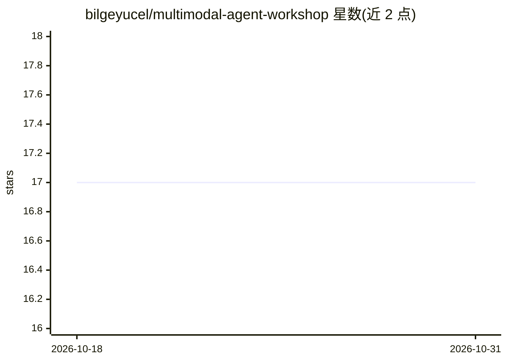

# bilgeyucel/multimodal-agent-workshop

⭐ 17 · Jupyter Notebook · MIT · 推送 2026-05-15 · [GitHub](https://github.com/bilgeyucel/multimodal-agent-workshop) · 个人维护

**动手教程：用 Haystack 与 GPT-4o 构建多模态 AI agent**

由 Bilge Yücel 编写的实践工作坊（workshop），指导参与者使用 Haystack 构建具备视觉能力的多模态 agent：涵盖 PDF 与图片的 CLIP 嵌入索引管线、GPT-4o 视觉 agent、公司政策 RAG 检索工具、对话记忆，以及针对敏感操作的人工介入（human-in-the-loop）控制。主体内容以 Jupyter Notebook 形式提供，另附 Hayhooks 集成脚本可将 agent 部署为 API，示例数据包含收据图片与政策文档。需要 Python 3.10+ 与 OpenAI API key。

## 筛选速览

| 维度 | 判定 | 备注 |
|---|---|---|
| AI 角色 | `ai-knowledge` | 知识聚合/清单类 |
| 许可风险 | `permissive` | MIT |
| 部署形态 | `None` |  |
| 模型依赖 | — | README 未给出锁定关系 |
| 硬件要求 | — | 无带数字的原话,不猜 |
| 安装摩擦 | `low` | 无编译、无系统依赖或容器化 |
| 成熟度 | — | 结构信号不足 |

## 能力要点

- PDF 与图片的 CLIP 多模态索引管线
- GPT-4o 视觉 agent 与公司政策 RAG 工具
- 对话记忆与敏感操作的人工介入控制
- Hayhooks 集成脚本支持将 agent 部署为 API

## 适用场景

- 学习如何用 Haystack 搭建多模态 agent
- 参考报销场景的多模态文档理解示例
- 了解 human-in-the-loop 安全控制的实现方式

## 场景标签

`教程课程` `RAG` `多模态` · 领域:知识与检索

## 证据(README 行号)

> L3: A hands-on workshop exploring multimodal AI agents with Haystack.
> L14: 👉 See **multimodal_agent_notebook.ipynb** for the full interactive experience.

## 星数曲线

2026-10-18 17 → 2026-10-31 17（+0）

---
*卡片 v1 · prompt 1.4 · 生成 2026-10-29 · 置信度 high · 依据 README sha `75737dd69726` · [字段定义](../../DATASET.md)*
