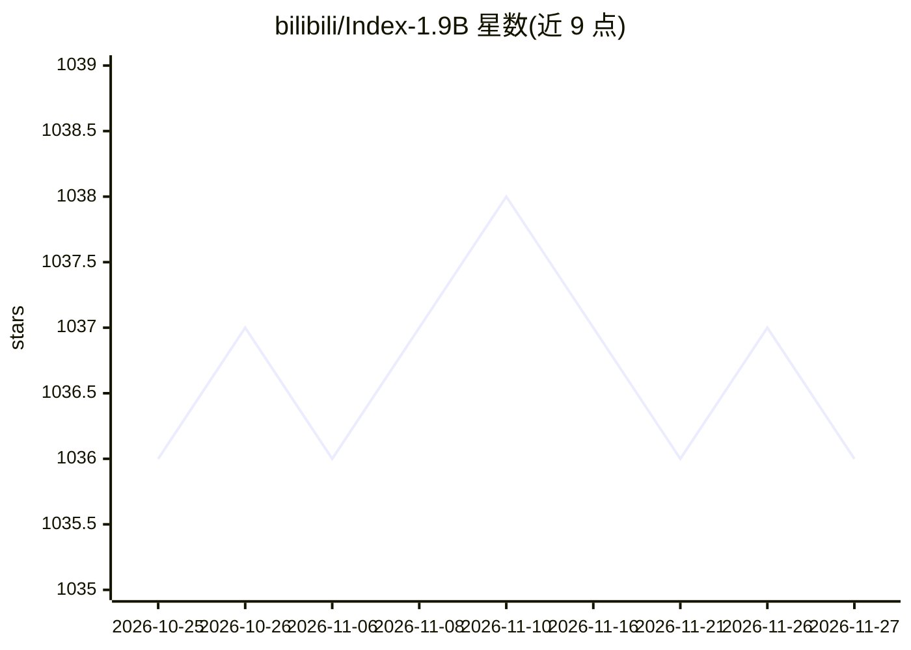

# bilibili/Index-1.9B

⭐ 1,036 · Python · Apache-2.0 · 推送 2026-10-26 · [GitHub](https://github.com/bilibili/Index-1.9B) · 组织维护 · 中文 README

**哔哩哔哩开源的 1.9B 轻量多语言对话模型系列**

Index 系列模型的轻量版本，包含 base、pure、chat、character（引入 RAG 实现少样本角色扮演定制）与 32K 长上下文共五个变体；base 在 2.8T 中英文语料上预训练，chat 基于 SFT 与 DPO 对齐。仓库提供 transformers 加载代码、Gradio 网页演示、终端演示、OpenAI 风格的 Flask API 服务、int4 量化脚本与微调教程；权重在 Hugging Face 与 ModelScope 发布，代码遵循 Apache-2.0，权重采用独立的 INDEX_MODEL_LICENSE（学术研究完全开放、支持免费商用）。

## 筛选速览

| 维度 | 判定 | 备注 |
|---|---|---|
| AI 角色 | `ai-native` | 本体是模型或模型工具 |
| 许可风险 | `permissive` | Apache-2.0 |
| 部署形态 | `library` | 以包/库形式分发 |
| 模型依赖 | local-ok | 支持本地模型 |
| 硬件要求 | — | 无带数字的原话,不猜 |
| 安装摩擦 | `low` | 无编译、无系统依赖或容器化 |
| 成熟度 | — | 结构信号不足 |

## 能力要点

- 五个变体：base/pure/chat/character/32K 长上下文
- character 版在 SFT+DPO 之上引入 RAG 实现少样本角色扮演定制
- 提供 Web/Terminal/OpenAI 风格 API 三种演示与 int4 量化、微调教程
- 模型权重学术研究完全开放并支持免费商用

## 适用场景

- 部署轻量中文为主的对话模型
- 用 RAG 语料创建自定义角色进行角色扮演对话
- 长文档（35,000 字以上）的读取、翻译与中文摘要
- 基于微调教程定制专属模型

## 场景标签

`聊天机器人` `微调` · 领域:对话与助手

## 证据(README 行号)

> L19: The Index-1.9B series is a lightweight version of the Index series models, including the following models:
> L23: - Index-1.9B character: Introduces RAG on top of SFT and DPO to achieve fewshots role-playing customization.
> L24: - Index-1.9B-32K: Index-1.9B-32K is a language model with only 1.9B parameters, but it supports a 32K context lengt

## 星数曲线

2026-10-25 1,036 → 2026-11-27 1,036（+0）

---
*卡片 v1 · prompt 1.4 · 生成 2026-11-24 · 置信度 high · 依据 README sha `d6a732ec5da3` · [字段定义](../../DATASET.md)*
