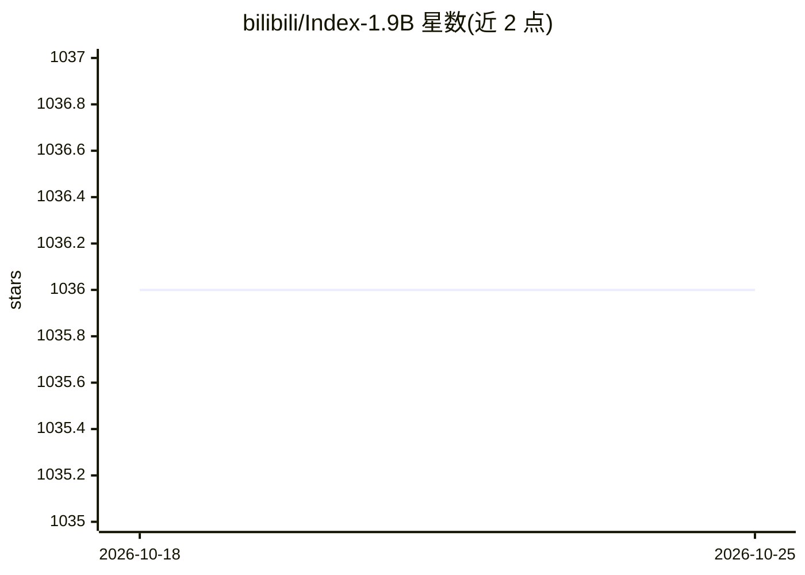

# bilibili/Index-1.9B

⭐ 1,037 · Python · Apache-2.0 · 推送 2026-10-16 · [GitHub](https://github.com/bilibili/Index-1.9B) · 组织维护 · 中文 README

**B 站开源的 1.9B 轻量多语言对话与角色扮演模型系列**

bilibili 开源的 Index 系列 1.9B 参数（非嵌入）小语言模型，含 base/pure/chat/character/32K 五个变体：chat 版经 SFT+DPO 对齐支持对话与多语言翻译，character 版基于 RAG 实现少样本角色扮演定制，32K 版支持 3.5 万字长文阅读、翻译与摘要。预训练语料 2.8T 以中英为主。仓库提供 Transformers 加载、Gradio Web Demo、终端 Demo、OpenAI 兼容 API Demo 与 int4 量化脚本；权重学术研究开放并支持免费商用（需遵守 INDEX_MODEL_LICENSE）。

## 筛选速览

| 维度 | 判定 | 备注 |
|---|---|---|
| AI 角色 | `ai-native` | 本体是模型或模型工具 |
| 许可风险 | `permissive` | Apache-2.0 |
| 部署形态 | `library` | 以包/库形式分发 |
| 模型依赖 | local-ok | 支持本地模型 |
| 硬件要求 | — | 无带数字的原话,不猜 |
| 安装摩擦 | `low` | 无编译、无系统依赖或容器化 |
| 成熟度 | — | 结构信号不足 |

## 能力要点

- 1.9B 参数含 5 个变体，chat 版支持多语言对话与翻译
- 32K 长上下文版可一次读取 3.5 万字以上文档并做翻译摘要
- RAG 支持的少样本角色扮演定制（内置角色“三三”）
- 已适配 llama.cpp 与 Ollama，并提供 GGUF 版本

## 适用场景

- 本地部署轻量中文对话或翻译模型
- 低参数量下做长文档翻译与摘要
- 基于语料定制角色扮演对话角色
- 在 Ollama/llama.cpp 环境中运行该模型

## 场景标签

`聊天机器人` · 领域:对话与助手

## 证据(README 行号)

> L20: - Index-1.9B base: Base model with 1.9 billion non-embedding parameters, pre-trained on 2.8T mainly Chinese and Eng
> L22: - Index-1.9B chat: A dialogue model aligned with SFT and DPO based on the index-1.9B base. We found that due to the
> L24: - Index-1.9B-32K: Index-1.9B-32K is a language model with only 1.9B parameters, but it supports a 32K context lengt

## 星数曲线

2026-10-18 1,036 → 2026-10-25 1,036（+0）

---
*卡片 v1 · prompt 1.4 · 生成 2026-10-21 · 置信度 high · 依据 README sha `e3b5e6d30676` · [字段定义](../../DATASET.md)*
