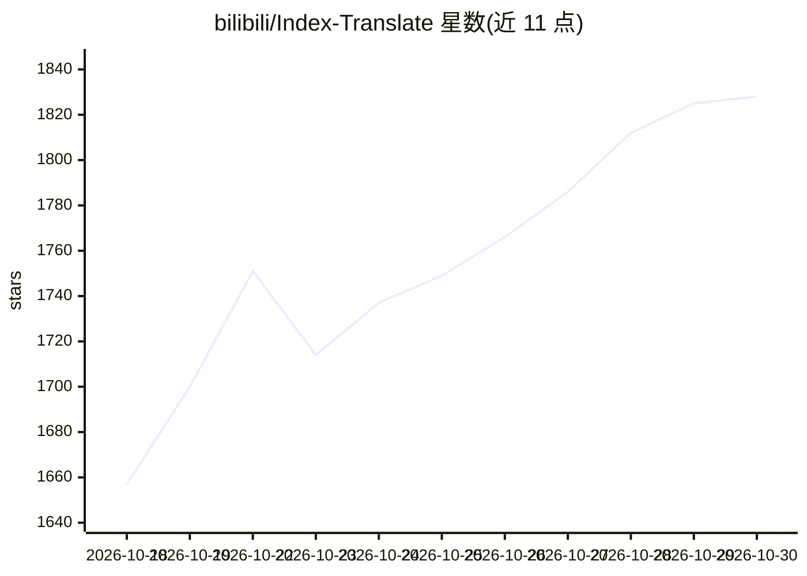

# bilibili/Index-Translate

⭐ 1,828 · Python · Apache-2.0 · 推送 2026-10-26 · [GitHub](https://github.com/bilibili/Index-Translate) · [官网](https://index-translate.bilibili.com) · 组织维护 · 中文 README

**B站开源的多语言多模态翻译模型家族（150 种语言）**

基于 Qwen3.5 构建的翻译模型家族，文本模型覆盖 150 种语言并支持术语表、格式保持等指令约束；家族扩展出 Index-Echo（语音转字幕 S2TT 与保留音色的跨语种配音 S2ST）、Index-Homura（按音节数控制的翻译）、Index-NativeLong（长文档翻译）。提供 2B/9B/35B-A3B 权重，发布 GGUF（llama.cpp 本地推理）与 FP8/NVFP4（vLLM 服务）量化版本，并提供免费 OpenAI 兼容公共 API 与本地桥接代理配合沉浸式翻译浏览器扩展。面向开发者与需要翻译能力的用户。

## 筛选速览

| 维度 | 判定 | 备注 |
|---|---|---|
| AI 角色 | `ai-native` | 本体是模型或模型工具 |
| 许可风险 | `permissive` | Apache-2.0 |
| 部署形态 | `library` | 以包/库形式分发 |
| 模型依赖 | local-ok | 支持本地模型 |
| 硬件要求 | — | 无带数字的原话,不猜 |
| 安装摩擦 | `medium` | 含编译或系统依赖之一 |
| 成熟度 | — | 结构信号不足 |

## 能力要点

- 文本翻译覆盖 150 种语言，支持硬性/软性指令约束（术语表、格式、风格）
- 原生视觉编码器的图像翻译，无 OCR 依赖
- 语音到字幕（S2TT）与保留源说话人音色的跨语种配音（S2ST）
- GGUF/FP8/NVFP4 量化版本与免费 OpenAI 兼容 API

## 适用场景

- 本地部署 vLLM 或 llama.cpp 做多语言文本/图像翻译
- 为视频生成字幕或保留音色的跨语种配音
- 浏览器内双语阅读（配合沉浸式翻译扩展）
- 按目标音节数控制的翻译用于配音对口型

## 场景标签

`多模态` · 领域:感知与多模态

## 证据(README 行号)

> L18: Index-Translate is a family of multilingual, multimodal translation models built on Qwen3.5. The text models cover 
> L20: - **Index-Translate (Text & Multimodal Vision)**: Covers 150 languages for text translation, with native support fo
> L21: - **Index-Echo (Multimodal Audio & Speech)**: End-to-end speech-to-subtitles (S2TT) and cross-lingual voice-cloned 

## 星数曲线

2026-10-18 1,657 → 2026-10-30 1,828（+171）

---
*卡片 v1 · prompt 1.4 · 生成 2026-10-21 · 置信度 high · 依据 README sha `75bf1ce3f219` · [字段定义](../../DATASET.md)*
