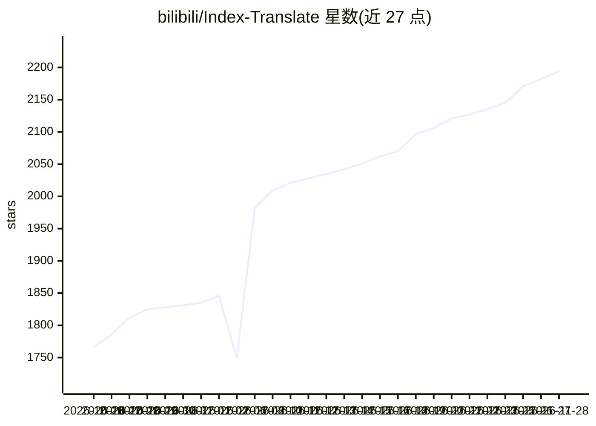

# bilibili/Index-Translate

⭐ 2,194 · Python · Apache-2.0 · 推送 2026-11-20 · [GitHub](https://github.com/bilibili/Index-Translate) · [官网](https://index-translate.bilibili.com) · 组织维护 · 中文 README

**B 站发布的多语言多模态翻译模型家族，含免费 API**

Bilibili 发布的翻译模型家族，基于 Qwen3.5，文本模型覆盖 150 种语言并遵循术语、格式等翻译指令。家族包含文本与图像翻译（Index-Translate）、语音转字幕与克隆配音（Index-Echo）、音节控制配音（Index-Homura）与长文档翻译（Index-NativeLong），Omni 版本整合文本、图像、中英文语音识别与语音到文本翻译。提供 2B/9B/35B-A3B 权重（Hugging Face 与 ModelScope）、GGUF/FP8/FP4 量化版、免费 OpenAI 兼容 API 与在线 Demo。

## 筛选速览

| 维度 | 判定 | 备注 |
|---|---|---|
| AI 角色 | `ai-native` | 本体是模型或模型工具 |
| 许可风险 | `permissive` | Apache-2.0 |
| 部署形态 | `library` | 以包/库形式分发 |
| 模型依赖 | local-ok | 支持本地模型 |
| 硬件要求 | — | 无带数字的原话,不猜 |
| 安装摩擦 | `medium` | 含编译或系统依赖之一 |
| 成熟度 | — | 结构信号不足 |

## 能力要点

- 文本翻译覆盖 150 种语言，支持术语与格式等翻译指令
- Omni 版本支持图像翻译、中英文 ASR 与中英双向语音翻译
- 提供 GGUF（llama.cpp）、FP8/FP4（vLLM）官方量化版
- 免费公开 API，OpenAI 兼容，零 GPU 调用

## 适用场景

- 调用免费 API 做多语言文本与图像翻译
- 语音转字幕或保留说话人音色的跨语言配音
- 保持术语一致的长文档整篇翻译
- 用 llama.cpp 在本地跑量化权重做翻译

## 场景标签

`语音识别` `多模态` · 领域:感知与多模态

## 证据(README 行号)

> L82: Index-Translate is a family of multilingual, multimodal translation models built on Qwen3.5. The text models cover 
> L84: - **Index-Translate (Text & Multimodal Vision)**: Covers 150 languages for text translation, with native support fo

## 星数曲线

2026-10-26 1,766 → 2026-11-28 2,194（+428）

---
*卡片 v1 · prompt 1.4 · 生成 2026-11-23 · 置信度 mid · 依据 README sha `ad85a98ef450` · [字段定义](../../DATASET.md)*
