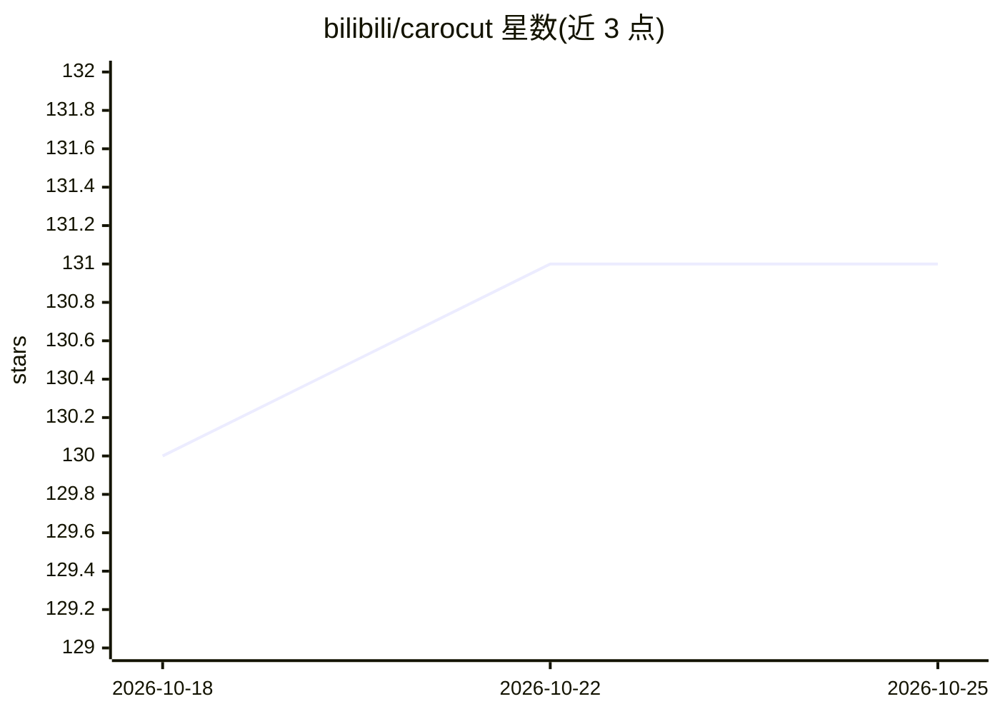

# bilibili/carocut

⭐ 131 · TypeScript · NOASSERTION · 推送 2026-04-20 · [GitHub](https://github.com/bilibili/carocut) · 组织维护 · 中文 README

**多 Agent 协作的端到端自动化视频生产平台**

bilibili 开源的 AI 视频制作工作流系统，基于 OpenCode AI SDK 与 Remotion 构建。通过 5 个 Agent（orchestrator/planner/media/builder/reviewer）与 12 个 Skill 的协作，把 PDF、图片、文本等原始素材经 8 步工作流（素材分析到预览渲染）转化为视频；Remotion 以 React 组件编程式生成视频，progress.yaml 支持断点续做。面向开发者，需 macOS/Linux 环境、Node.js/Python/uv/ffmpeg 及 Pexels API 密钥，从源码克隆安装，不支持 Windows（需 WSL2）。

## 筛选速览

| 维度 | 判定 | 备注 |
|---|---|---|
| AI 角色 | `ai-native` | 本体是模型或模型工具 |
| 许可风险 | `none` | NOASSERTION |
| 部署形态 | `None` |  |
| 模型依赖 | — | README 未给出锁定关系 |
| 硬件要求 | — | 无带数字的原话,不猜 |
| 安装摩擦 | `medium` | 含编译或系统依赖之一 |
| 成熟度 | — | 结构信号不足 |

## 能力要点

- 5 个专业 Agent + 12 个 Skill 的多 Agent 协作架构
- 8 步标准工作流：从素材分析到预览渲染
- Remotion 驱动，React 组件编程式生成视频
- progress.yaml 状态持久化，支持断点续做与增量修改

## 适用场景

- 把 PDF、图片、文本素材自动加工成讲解类视频
- 论文讲解或网页设计类内容的多 Agent 视频生产
- 需要中断恢复的长流程视频制作任务

## 场景标签

`多智能体` `工作流自动化` · 领域:Agent 开发

## 证据(README 行号)

> L3: AI 驱动的视频制作工作流系统，基于 OpenCode AI SDK 和 Remotion 构建。
> L7: CaroCut 是端到端的自动化视频生产平台。通过多 Agent 协作（orchestrator + planner/media/builder/reviewer），将原始素材（PDF、图片、文本）转化为专业视频。
> L70: 在 OpenCode 界面输入 `/carocut`，系统自动执行完整视频制作流水线。

## 星数曲线

2026-10-18 130 → 2026-10-25 131（+1）

---
*卡片 v1 · prompt 1.4 · 生成 2026-10-22 · 置信度 high · 依据 README sha `84c43c97e285` · [字段定义](../../DATASET.md)*
